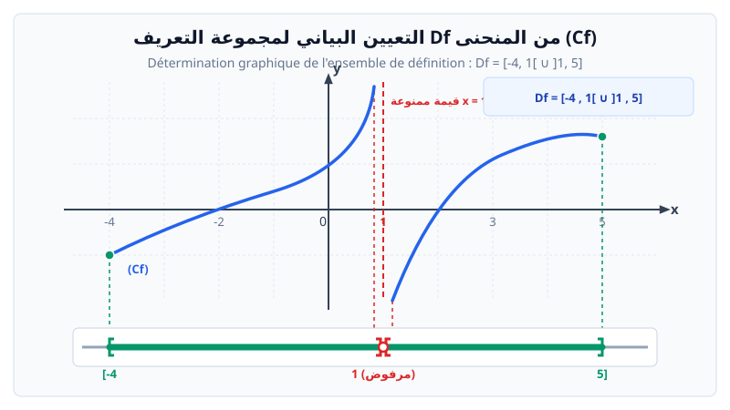

# مجموعة تعريف دالة عددية ($D$)

> **تعريف:**  
> مجموعة تعريف دالة $f$ هي مجموعة كل الأعداد الحقيقية $x$ التي من أجلها يكون للعبارة $f(x)$ معنى (أي قابلة للحساب في $\mathbb{R}$). نرمز لها بالرمز $D_f$.

---

## 1. التعيين بيانياً

تُحدد مجموعة التعريف من التمثيل البياني للدالة بإسقاط منحنى الدالة $(C_f)$ على محور الفواصل $(x'x)$ من أقصى نقطة يساراً إلى أقصى نقطة يميناً، مع مراعاة النقاط المفتوحة أو المقاربات:

* **الدالة المستمرة على $\mathbb{R}$:**
  $$D_f = ]-\infty, +\infty[ = \mathbb{R}$$
* **الدالة المعرفة على النصف الموجب (مثل الجذر التربيعي):**
  $$D_g = [0, +\infty[$$
* **الدالة المعرفة باستثناء الصفر (مثل مقلوب):**
  $$D_h = ]-\infty, 0[\, \cup\, ]0, +\infty[ = \mathbb{R}^*$$
* **الدالة المعرفة على مجال مغلق ومحدود:**
  $$D_p = [-2, 3]$$
* **الدوال ذات القيم الممنوعة أو المجالات غير المترابطة:**
  $$D_k = ]-\infty, -1[\, \cup\, ]-1, 1[\, \cup\, ]1, +\infty[ = \mathbb{R} \setminus \{-1, 1\}$$
  $$D_M = ]-\infty, -2]\, \cup\, ]1, +\infty[$$

---

## 2. التعيين حسابياً (جبرياً)

### أ. الدالة كثيرة الحدود (لا كسر ولا جذر)
تكون معرفة دائماً على $\mathbb{R}$:
$$f(x) = 6x^2 - 15x + 8 \implies D_f = \mathbb{R} = ]-\infty, +\infty[$$

### ب. الدالة الكسرية (المقام يتضمن المجهول $x$)
يجب أن يكون المقام غير معدوم:
$$f(x) = \frac{x^2 + 7}{x - 2}$$
> **الشرط:**
> $$x - 2 \neq 0 \implies x \neq 2$$
> **إذن:**
> $$D_f = \mathbb{R} \setminus \{2\} = ]-\infty, 2[\, \cup\, ]2, +\infty[$$

### ج. الدالة الصماء / الجذرية (ما تحت الجذر يتضمن المجهول $x$)
يجب أن يكون ما بداخل الجذر أكبر من أو يساوي الصفر:
$$f(x) = \sqrt{x - 3}$$
> **الشرط:**
> $$x - 3 \ge 0 \implies x \ge 3$$
> **إذن:**
> $$D_f = [3, +\infty[$$

### د. حالات مركبة (كسر وجذر معاً)

* **المثال الأول (الجذر في المقام فقط):**
  $$f(x) = \frac{3x - 1}{\sqrt{x + 5}}$$
  > **الشرط:** ما بداخل الجذر موجب تماماً:
  > $$x + 5 > 0 \implies x > -5$$
  > $$D_f = ]-5, +\infty[$$

* **المثال الثاني (جذر مضاف إليه كسر):**
  $$f(x) = \sqrt{x + 4} + \frac{9}{x - 6}$$
  > **الشرط:**
  > $$\begin{cases} x + 4 \ge 0 \\ x - 6 \neq 0 \end{cases} \implies \begin{cases} x \ge -4 \\ x \neq 6 \end{cases}$$
  > $$D_f = [-4, 6[\, \cup\, ]6, +\infty[$$

---

## 3. القواعد العامة لتحديد مجموعة التعريف

> 1. **انعدام الكسر والجذر:** $D_f = \mathbb{R} = ]-\infty, +\infty[$
> 2. **في الكسر:** نضع شرط: $\text{المقام} \neq 0$.
> 3. **في الجذر التربيعي:** نضع شرط: $\text{ما داخل الجذر} \ge 0$.
> 4. **في مجموع أو فرق أو جداء دوال:** مجموعة التعريف هي تقاطع مجالات تعريف كل دالة على حدة.

---

## 4. ملخص الأشكال النموذجية

| عبارة الدالة $f(x)$ | شرط الوجود | مجموعة التعريف $D_f$ |
| :--- | :--- | :--- |
| $f(x) = P(x)$ (كثير حدود) | لا يوجد قيود | $D_f = \mathbb{R}$ |
| $f(x) = \dfrac{g(x)}{h(x)}$ | $h(x) \neq 0$ | $D_f = \{x \in \mathbb{R} \mid h(x) \neq 0\}$ |
| $f(x) = \sqrt{g(x)}$ | $g(x) \ge 0$ | $D_f = \{x \in \mathbb{R} \mid g(x) \ge 0\}$ |
| $f(x) = \dfrac{g(x)}{\sqrt{h(x)}}$ | $h(x) > 0$ | $D_f = \{x \in \mathbb{R} \mid h(x) > 0\}$ |
| $f(x) = \sqrt{g(x)} + \dfrac{h(x)}{k(x)}$ | $g(x) \ge 0 \text{ و } k(x) \neq 0$ | $D_f = \{x \in \mathbb{R} \mid g(x) \ge 0 \land k(x) \neq 0\}$ |
| $f(x) = \dfrac{\sqrt{g(x)}}{\sqrt{h(x)}}$ | $g(x) \ge 0 \text{ و } h(x) > 0$ | $D_f = \{x \in \mathbb{R} \mid g(x) \ge 0 \land h(x) > 0\}$ |
| $f(x) = \sqrt{\dfrac{g(x)}{h(x)}}$ | $\dfrac{g(x)}{h(x)} \ge 0 \text{ و } h(x) \neq 0$ | $D_f = \left\{x \in \mathbb{R} \;\middle|\; \dfrac{g(x)}{h(x)} \ge 0 \land h(x) \neq 0\right\}$ |

*(حيث $g(x)$ و $h(x)$ و $k(x)$ دوال كثيرات حدود).*

---

## 5. العمليات على الدوال ومجموعة التعريف

لتكن $f$ و $g$ دالتين معرفتين على $D_f$ و $D_g$ على الترتيب، وليكن $\lambda \in \mathbb{R}$ و $k \in \mathbb{R}$:

| العملية | الرمز | مجموعة التعريف |
| :--- | :---: | :--- |
| **إضافة ثابت** | $f + k$ | $D_{f+k} = D_f$ |
| **الضرب في عدد حقيقي** | $\lambda f$ | $D_{\lambda f} = D_f \quad (\lambda \neq 0)$ |
| **مجموع دالتين** | $f + g$ | $D_{f+g} = D_f \cap D_g$ |
| **جداء دالتين** | $f \times g$ | $D_{f \times g} = D_f \cap D_g$ |
| **حاصل قسمة دالتين** | $\dfrac{f}{g}$ | $D_{f/g} = \{x \in D_f \cap D_g \mid g(x) \neq 0\}$ |
| **تركيب دالتين** | $f \circ g$ | $D_{f \circ g} = \{x \in D_g \mid g(x) \in D_f\}$ |

---

## 6. بنك التمارين التدريبية والنموذجية (مع الحلول المفصلة خطوة بخطوة)

### 📌 التمرين الأول (تطبيقي مباشر - تعيين مجموعة التعريف جبرياً)
عيّن مجموعة تعريف كل دالة من الدوال العددية التالية:
1. $f_1(x) = \dfrac{3x - 1}{2x^2 - 8}$
2. $f_2(x) = \sqrt{4 - 2x}$
3. $f_3(x) = \dfrac{x^2 + 1}{\sqrt{x^2 - 9}}$
4. $f_4(x) = \sqrt{\dfrac{x - 3}{x + 2}}$
5. $f_5(x) = \dfrac{\sqrt{x + 4}}{|x| - 2}$
6. $f_6(x) = \sqrt{x + 2} + \sqrt{6 - x}$

---

### 💡 الحل المفصل للتمرين الأول:

1. **بالنسبة لـ $f_1(x) = \dfrac{3x - 1}{2x^2 - 8}$:**
   * **الشرط:** المقام يختلف عن الصفر: $2x^2 - 8 \neq 0 \iff x^2 - 4 \neq 0 \iff (x - 2)(x + 2) \neq 0$.
   * إذن: $x \neq 2$ و $x \neq -2$.
   * **النتيجة:** $D_{f_1} = \mathbb{R} \setminus \{-2, 2\} = ]-\infty, -2[\, \cup\, ]-2, 2[\, \cup\, ]2, +\infty[$.

2. **بالنسبة لـ $f_2(x) = \sqrt{4 - 2x}$:**
   * **الشرط:** ما تحت الجذر موجب أو معدوم: $4 - 2x \ge 0 \iff -2x \ge -4 \iff x \le 2$ (قلبنا اتجاه التراجع بالقسمة على عدد سالب).
   * **النتيجة:** $D_{f_2} = ]-\infty, 2]$.

3. **بالنسبة لـ $f_3(x) = \dfrac{x^2 + 1}{\sqrt{x^2 - 9}}$:**
   * **الشرط:** الجذر في المقام، إذن يجب أن يكون ما بداخل الجذر موجباً تماماً: $x^2 - 9 > 0$.
   * جذرا كثير الحدود $x^2 - 9 = 0$ هما $x = -3$ و $x = 3$.
   * إشارة ثلاثي الحدود (معامل $x^2$ موجب $a = 1 > 0$): موجب خارج مجال الجذرين.
   * **النتيجة:** $D_{f_3} = ]-\infty, -3[\, \cup\, ]3, +\infty[$.

4. **بالنسبة لـ $f_4(x) = \sqrt{\dfrac{x - 3}{x + 2}}$:**
   * **الشرط:** حاصل القسمة موجب أو معدوم والمقام غير معدوم: $\dfrac{x - 3}{x + 2} \ge 0$ و $x + 2 \neq 0$.
   * ندرس إشارة الكسر بجدول الإشارة:
     * ينعدم البسط عند $x = 3$.
     * ينعدم المقام عند القيمة الممنوعة $x = -2$.
     * إشارة الكسر موجبة على $]-\infty, -2[$ وعلى $[3, +\infty[$.
   * **النتيجة:** $D_{f_4} = ]-\infty, -2[\, \cup\, [3, +\infty[$.

5. **بالنسبة لـ $f_5(x) = \dfrac{\sqrt{x + 4}}{|x| - 2}$:**
   * **الشرط:**
     $$\begin{cases} x + 4 \ge 0 \\ |x| - 2 \neq 0 \end{cases} \iff \begin{cases} x \ge -4 \\ |x| \neq 2 \iff x \neq 2 \text{ و } x \neq -2 \end{cases}$$
   * **النتيجة:** $D_{f_5} = [-4, -2[\, \cup\, ]-2, 2[\, \cup\, ]2, +\infty[$.

6. **بالنسبة لـ $f_6(x) = \sqrt{x + 2} + \sqrt{6 - x}$:**
   * **الشرط:** شرطا الوجود معاً (التقاطع):
     $$\begin{cases} x + 2 \ge 0 \iff x \ge -2 \\ 6 - x \ge 0 \iff x \le 6 \end{cases}$$
   * تقاطع المجالين $[-2, +\infty[ \;\cap\; ]-\infty, 6]$ هو المجال المغلق $[-2, 6]$.
   * **النتيجة:** $D_{f_6} = [-2, 6]$.

---

### 📌 التمرين الثاني (مسألة تركيب الدوال ومجموعة التعريف - نموذج الفروض)
لتكن الدالتان $u$ و $v$ المعرفتان بـ:
$$u(x) = 2x - 4 \quad \text{و} \quad v(x) = \dfrac{1}{x + 1}$$
1. حدد $D_u$ و $D_v$.
2. حدد مجموعة تعريف الدالة المركبة $g = v \circ u$.
3. أعط عبارة الدالة $g(x)$.
4. حدد مجموعة تعريف الدالة $h = u \circ v$ وأعط عبارتها.

---

### 💡 الحل المفصل للتمرين الثاني:
1. $u$ دالة تآلفية (كثير حدود): $D_u = \mathbb{R}$.  
   $v$ دالة كسرية: المقام $x + 1 \neq 0 \iff x \neq -1 \implies D_v = \mathbb{R} \setminus \{-1\}$.

2. **مجموعة تعريف $g = v \circ u$:**
   القاعدة العامة: $D_{v \circ u} = \{x \in D_u \mid u(x) \in D_v\}$.
   * بما أن $D_u = \mathbb{R}$، فالشرط ينحصر في: $u(x) \in D_v \iff u(x) \neq -1$.
   * نحل المعادلة: $2x - 4 = -1 \iff 2x = 3 \iff x = \dfrac{3}{2}$.
   * القيمة المرفوضة هي $x = \dfrac{3}{2}$.
   * **النتيجة:** $D_{v \circ u} = \mathbb{R} \setminus \left\{\dfrac{3}{2}\right\} = \left]-\infty, \dfrac{3}{2}\right[\, \cup\, \left]\dfrac{3}{2}, +\infty\right[$.

3. **عبارة الدالة $g(x) = (v \circ u)(x)$:**
   $$g(x) = v(u(x)) = \dfrac{1}{u(x) + 1} = \dfrac{1}{(2x - 4) + 1} = \dfrac{1}{2x - 3}$$

4. **مجموعة تعريف وعبارة $h = u \circ v$:**
   * $D_{u \circ v} = \{x \in D_v \mid v(x) \in D_u\}$.
   * بما أن $D_u = \mathbb{R}$، فإن الشرط $v(x) \in \mathbb{R}$ محقق دائماً لكل $x \in D_v$.
   * إذن: $D_{u \circ v} = D_v = \mathbb{R} \setminus \{-1\}$.
   * العبارة:
     $$h(x) = u(v(x)) = 2 v(x) - 4 = 2\left(\dfrac{1}{x + 1}\right) - 4 = \dfrac{2 - 4(x + 1)}{x + 1} = \dfrac{-4x - 2}{x + 1}$$
