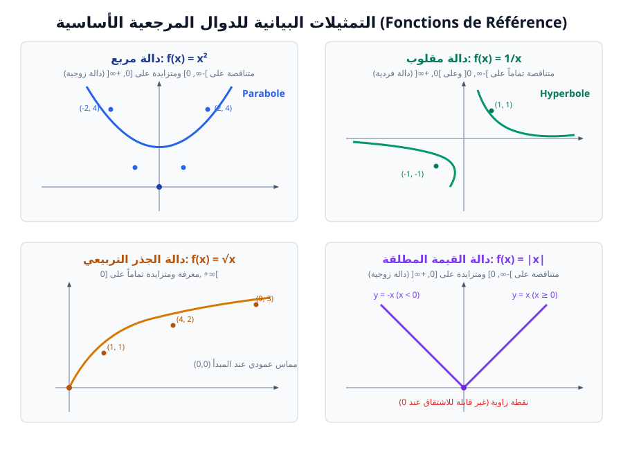

# الدوال المرجعية

> **تذكير:**  
> الدوال المرجعية هي دوال أساسية تُستخدم كقاعدة لبناء ودراسة دوال أكثر تعقيداً عن طريق التحويلات النقطية (الانسحاب، التناظر، التمدد والانضغاط).

---

## 1. جدول الدوال المرجعية الأساسية

| الدالة | العبارة $f(x)$ | مجموعة التعريف $D_f$ | الشفعية | اتجاه التغير |
| :--- | :---: | :---: | :---: | :--- |
| **دالة مربع** | $x^2$ | $\mathbb{R}$ | زوجية | متناقصة تماماً على $]-\infty, 0]$، متزايدة تماماً على $[0, +\infty[$ |
| **دالة مقلوب** | $\dfrac{1}{x}$ | $\mathbb{R}^*$ | فردية | متناقصة تماماً على $]-\infty, 0[$ وعلى $]0, +\infty[$ |
| **دالة جذر تربيعي** | $\sqrt{x}$ | $[0, +\infty[$ | لا زوجية ولا فردية | متزايدة تماماً على $[0, +\infty[$ |
| **دالة القيمة المطلقة** | $\lvert x \rvert$ | $\mathbb{R}$ | زوجية | متناقصة تماماً على $]-\infty, 0]$، متزايدة تماماً على $[0, +\infty[$ |
| **دالة مكعب** | $x^3$ | $\mathbb{R}$ | فردية | متزايدة تماماً على $\mathbb{R}$ |
| **دالة جيب التمام** | $\cos(x)$ | $\mathbb{R}$ | زوجية (دورية دورها $2\pi$) | متناقصة على $[0, \pi]$ |
| **دالة الجيب** | $\sin(x)$ | $\mathbb{R}$ | فردية (دورية دورها $2\pi$) | متزايدة على $\left[0, \frac{\pi}{2}\right]$، متناقصة على $\left[\frac{\pi}{2}, \pi\right]$ |

---

## 2. التمثيل البياني للدوال المشتقة من الدوال المرجعية

لكل دالة مرجعية، يمكن استنتاج التمثيل البياني للدالة $g(x) = \lambda f(x + b) + k$ انطلاقاً من منحنى الدالة المرجعية $f$:

### أ. الدالة المربعة المعممة: $g(x) = \lambda (x + b)^2 + k$
1. نرسم منحنى الدالة المرجعية المضروبة في معامل: $y = \lambda x^2$.
2. نستنتج المنحنى $(C_g)$ بالانسحاب الذي شعاعه:
   $$\vec{v} = \begin{pmatrix} -b \\ k \end{pmatrix}$$
   أو في معلم جديد مبدؤه $\Omega(-b, k)$.

### ب. دالة مقلوب معممة (الدالة التناظرية): $g(x) = \dfrac{\lambda}{x + b} + k$
1. نرسم المنحنى $y = \dfrac{\lambda}{x}$.
2. نستنتج $(C_g)$ بالانسحاب ذي الشعاع:
   $$\vec{v} = \begin{pmatrix} -b \\ k \end{pmatrix}$$
> **خواص هندسية:**  
> يقبل منحنى الدالة التناظرية مستقيمين مقاربين:
> * مستقيم مقارب عمودي معادلته: $x = -b$.
> * مستقيم مقارب أفقي معادلته: $y = k$.
> * مركز تناظر عند النقطة $\Omega(-b, k)$.

### ج. دالة الجذر التربيعي المعممة: $g(x) = \lambda \sqrt{x + b} + k$
1. نرسم المنحنى $y = \lambda \sqrt{x}$.
2. نسحب المنحنى وفق الشعاع $\vec{v}(-b, k)$. مبدأ نصف المنحنى يصبح النقطة $\Omega(-b, k)$.

### د. دالة القيمة المطلقة المعممة: $g(x) = \lambda \lvert x + b \rvert + k$
1. نرسم المنحنى $y = \lambda \lvert x \rvert$.
2. نسحب المنحنى وفق الشعاع $\vec{v}(-b, k)$، ورأس زاوية المنحنى يكون عند النقطة $\Omega(-b, k)$.

---

## 3. التحويلات الهندسية العامة للمنحنيات

إذا كان $(C_f)$ هو التمثيل البياني للدالة $f$:

> * **الانسحاب الرأسي:** $g(x) = f(x) + k \implies (C_g)$ صورة $(C_f)$ بانسحاب شعاعه $\vec{v}(0, k)$.
> * **الانسحاب الأفقي:** $g(x) = f(x + b) \implies (C_g)$ صورة $(C_f)$ بانسحاب شعاعه $\vec{v}(-b, 0)$.
> * **الانسحاب المركب:** $g(x) = f(x + b) + k \implies (C_g)$ صورة $(C_f)$ بانسحاب شعاعه $\vec{v}(-b, k)$.
> * **التناظر بالنسبة لمحور الفواصل:** $g(x) = -f(x)$.
> * **التناظر بالنسبة لمحور التراتيب:** $g(x) = f(-x)$.
> * **التناظر بالنسبة لمبدأ المعلم:** $g(x) = -f(-x)$.
> * **القيمة المطلقة للدالة:**
>   $$g(x) = \lvert f(x) \rvert = \begin{cases} f(x) & \text{لما } f(x) \ge 0 \\ -f(x) & \text{لما } f(x) < 0 \end{cases}$$
>   أي: ينطبق $(C_g)$ على $(C_f)$ فوق محور الفواصل، ونناظر الجزء السفلي بالنسبة لمحور الفواصل.
> * **القيمة المطلقة للمتغير:**
>   $$g(x) = f(\lvert x \rvert)$$
>   الدالة $g$ زوجية: ينطبق $(C_g)$ على $(C_f)$ في المجال $[0, +\infty[$، ثم نناظره بالنسبة لمحور التراتيب في المجال $]-\infty, 0]$.

---

## 4. بنك التمارين والمسائل التدريبية (مع الحلول النموذجية)

### 📌 التمرين الأول: تفكيك الدوال وتعيين اتجاه التغير
لتكن الدالة $f$ المعرفة على $]1, +\infty[$ بـ:
$$f(x) = \dfrac{2x - 1}{x - 1}$$
1. أوجد العددين الحقيقيين $a$ و $b$ بحيث يكون من أجل كل $x > 1$:
   $$f(x) = a + \dfrac{b}{x - 1}$$
2. فكك الدالة $f$ إلى مركب دوال مرجعية بسيطة.
3. استنتج اتجاه تغير الدالة $f$ على المجال $]1, +\infty[$.
4. اشرح كيف يمكن إنشاء المنحنى $(C_f)$ انطلاقاً من منحنى دالة مقلوب $y = \dfrac{1}{x}$.

---

### 💡 الحل المفصل للتمرين الأول:
1. **إيجاد $a$ و $b$ بالقسمة الإقليدية أو المطابقة:**
   $$a + \dfrac{b}{x - 1} = \dfrac{a(x - 1) + b}{x - 1} = \dfrac{ax - a + b}{x - 1}$$
   بالمطابقة مع $\dfrac{2x - 1}{x - 1}$:
   $$egin{cases} a = 2 \ -a + b = -1 \implies -2 + b = -1 \implies b = 1 \end{cases}$$
   إذن:
   $$f(x) = 2 + \dfrac{1}{x - 1}$$

2. **تفكيك الدالة $f$ إلى مركب دالتين مرجعيتين:**
   نضع:
   * $u(x) = x - 1$ (دالة تآلفية متزايدة تماماً على $\mathbb{R}$).
   * $v(X) = 2 + \dfrac{1}{X}$ (دالة من الشكل $\dfrac{1}{X} + 2$ متناقصة تماماً على $]0, +\infty[$).
   * إذن: $f = v \circ u$.

3. **اتجاه تغير الدالة $f$ على $]1, +\infty[$:**
   * ليكن $x \in ]1, +\infty[$: فإن $u(x) = x - 1 > 0$، أي $u(x) \in ]0, +\infty[$.
   * الدالة $u$ متزايدة تماماً على $]1, +\infty[$.
   * الدالة $v$ متناقصة تماماً على المجال $]0, +\infty[$.
   * قاعدة مركب دالتين: تركيب دالة متزايدة مع دالة متناقصة ينتج **دالة متناقصة تماماً**.
   * **النتيجة:** الدالة $f$ متناقصة تماماً على المجال $]1, +\infty[$.

4. **إنشاء $(C_f)$ بالانسحاب:**
   * العبارة هي: $y = 2 + \dfrac{1}{x - 1}$.
   * منحنى الدالة $f$ هو صورة منحنى الدالة مقلوب $y = \dfrac{1}{x}$ بالانسحاب الذي شعاعه:
     $$ec{v} = egin{pmatrix} 1 \ 2 \end{pmatrix}$$
   * المستقيمان المقاربان هما: $x = 1$ (مقارب عمودي) و $y = 2$ (مقارب أفقي)، ونقطة تقاطعهما $\Omega(1, 2)$ هي مركز تناظر للمنحنى $(C_f)$.

---

### 📌 التمرين الثاني: دراسة دالة تتضمن قيمة مطلقة
لتكن الدالة $g$ المعرفة على $\mathbb{R}$ بـ:
$$g(x) = |x^2 - 4|$$
1. اكتب عبارة $g(x)$ دون رمز القيمة المطلقة حسب قيم $x$.
2. بين أن الدالة $g$ زوجية.
3. اشرح كيفية إنشاء منحنى $(C_g)$ انطلاقاً من منحنى الدالة المربعة المعممة $P(x) = x^2 - 4$.

---

### 💡 الحل المفصل للتمرين الثاني:
1. **كتابة $g(x)$ دون رمز القيمة المطلقة:**
   * ثلاثي الحدود $x^2 - 4 = (x - 2)(x + 2)$ ينعدم عند $x = -2$ و $x = 2$.
   * إشارة $x^2 - 4$:
     * موجب خارج المجال $[-2, 2]$: لما $x \in ]-\infty, -2] \cup [2, +\infty[$.
     * سالب داخل المجال $]-2, 2[$: لما $x \in ]-2, 2[$.
   * وعليه:
     $$g(x) = egin{cases} x^2 - 4 & 	ext{إذا كان } x \in ]-\infty, -2] \cup [2, +\infty[ \ -(x^2 - 4) = 4 - x^2 & 	ext{إذا كان } x \in ]-2, 2[ \end{cases}$$

2. **إثبات شفعية الدالة $g$:**
   * من أجل كل $x \in \mathbb{R}$، لدينا $-x \in \mathbb{R}$.
   * $g(-x) = |(-x)^2 - 4| = |x^2 - 4| = g(x)$.
   * إذن الدالة $g$ **دالة زوجية**، ومنحناها متناظر بالنسبة لمحور التراتيب $(y'y)$.

3. **طريقة إنشاء المنحنى $(C_g)$:**
   * نرسم أولاً منحنى القطع المكافئ $y = x^2 - 4$ (المحصل عليه بسحب الدالة مربع $y = x^2$ بشعاع $ec{v}(0, -4)$ نحو الأسفل بمقدار 4 وحدات).
   * على المجالين $]-\infty, -2]$ و $[2, +\infty[$: بما أن $x^2 - 4 \ge 0$، فإن $(C_g)$ **ينطبق تماماً** على منحنى $x^2 - 4$.
   * على المجال $]-2, 2[$: بما أن $x^2 - 4 < 0$، فإننا **نناظر الجزء الواقع تحت محور الفواصل بالنسبة لمحور الفواصل $(x'x)$ نحو الأعلى** ليصبح ذروته عند $(0, 4)$ بدلاً من $(0, -4)$.
