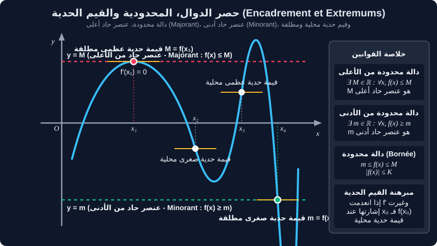

# حصر الدوال، المحدودية والقيم الحدية

> **أهمية الحصر والمحدودية:**  
> تُعد دراسة محدودية الدوال وحصرها من أهم أدوات التحليل الرياضي لحساب النهايات غير المباشرة (مبرهنة الحصر)، تقدير الخطأ في التقريب التآلفي، وحل مسائل الاستمثال (Optimisation) الهندسية والفيزيائية.

---

## 1. الدوال المحدودة والعناصر الحادة

لتكن $f$ دالة معرفة على مجال أو مجموعة تعريف $D$.

### أ. دالة محدودة من الأعلى (Fonction majorée)
نقول إن الدالة $f$ **محدودة من الأعلى** على $D$ إذا وُجد عدد حقيقي $M$ بحيث:
$$\forall x \in D, \quad f(x) \leq M$$
* يُسمى العدد $M$ **عنصراً حاداً من الأعلى** (Majorant) للدالة $f$.
* إذا كان $M$ عنصراً حاداً، فإن أي عدد أكبر من $M$ هو أيضاً عنصر حاد.

### ب. دالة محدودة من الأدنى (Fonction minorée)
نقول إن الدالة $f$ **محدودة من الأدنى** على $D$ إذا وُجد عدد حقيقي $m$ بحيث:
$$\forall x \in D, \quad f(x) \geq m$$
* يُسمى العدد $m$ **عنصراً حاداً من الأدنى** (Minorant) للدالة $f$.

### جـ. دالة محدودة (Fonction bornée)
نقول إن الدالة $f$ **محدودة** على $D$ إذا كانت محدودة من الأعلى ومن الأدنى في آن واحد:
$$\forall x \in D, \quad m \leq f(x) \leq M \quad \Longleftrightarrow \quad \exists K \in \mathbb{R}^+, \forall x \in D, \ |f(x)| \leq K$$

> **ملاحظة فارقة:**  
> العنصر الحاد $M$ لا يُشترط أن تبلغه الدالة. أما إذا وُجدت نقطة $x_0 \in D$ بحيث $f(x_0) = M$، فإن $M$ يُسمى عندئذٍ **قيمة حدية عظمى مطلقة** (Maximum global).

---

## 2. تقنيات وطرق حصر الدوال

### أ. الحصر باستعمال اتجاه التغير
لتكن $f$ دالة مستمرة ورتيبة تماماً على مجال $[a, b]$:
* **إذا كانت $f$ متزايدة تماماً على $[a, b]$:**
  $$a \leq x \leq b \quad \Longrightarrow \quad f(a) \leq f(x) \leq f(b)$$
* **إذا كانت $f$ متناقصة تماماً على $[a, b]$:**
  $$a \leq x \leq b \quad \Longrightarrow \quad f(b) \leq f(x) \leq f(a)$$

### ب. الحصر باستعمال خواص الدوال المرجعية
* للدوال المثلثية الأساسية:
  $$\forall x \in \mathbb{R}, \quad -1 \leq \cos(x) \leq 1 \quad \text{و} \quad -1 \leq \sin(x) \leq 1$$
* للدالة الجذر التربيعي: $x \geq 0 \Longrightarrow \sqrt{x} \geq 0$.
* للدالة المربع: $x \in \mathbb{R} \Longrightarrow x^2 \geq 0$.

### جـ. الحصر باستعمال إشارة المشتقة وتغيراتها
إذا كانت المشتقة $f'$ محدودة على مجال $[a, b]$، أي: $m \leq f'(x) \leq M$ لكل $x \in [a, b]$، فإنه لكل $x \in [a, b]$:
$$m(x - a) \leq f(x) - f(a) \leq M(x - a)$$
وهذه هي متباينة التزايدات المنتهية (Inégalité des accroissements finis).

---

## 3. القيم الحدية والمشتقة الأولى

لتكن $f$ دالة قابلة للاشتقاق على مجال مفتوح $I$ من $D_f$، وليكن $x_0 \in I$:

> **مبرهنة القيمة الحدية المحلية:**  
> إذا انعدمت المشتقة الأولى $f'$ عند $x_0$ **وغيرت إشارتها**، فإن النقطة $(x_0, f(x_0))$ توافق **قيمة حدية محلية** (Extremum local):
> 1. إذا تغيرت إشارة $f'$ من الموجب إلى السالب ($+ \to -$): $f(x_0)$ هي **قيمة حدية عظمى محلية**.
> 2. إذا تغيرت إشارة $f'$ من السالب إلى الموجب ($- \to +$): $f(x_0)$ هي **قيمة حدية صغرى محلية**.

* **تنبيه:** إذا كانت $f'(x_0) = 0$ دون أن تغير إشارتها (تبقى موجبة على جانبي $x_0$ أو سالبة على الجانبين)، فإن $f(x_0)$ **ليست** قيمة حدية، بل نقطة انعطاف بمماس أفقي (مثل دالة التكعيب $f(x) = x^3$ عند $x = 0$).

---

## 4. تمارين تطبيقية نموذجية مع الحل المفصل

### تمرين 1: دراسة محدودية دالة ناطقة
لتكن الدالة $f$ المعرفة على $\mathbb{R}$ بالعبارة:
$$f(x) = \frac{2x}{x^2 + 1}$$
1. بيّن أن الدالة $f$ فردية.  
2. احسب المشتقة $f'(x)$ وادرس إشارتها ثم شكّل جدول تغيرات $f$.  
3. استنتج أن الدالة $f$ محدودة على $\mathbb{R}$ وعيّن عناصرها الحادة القصوى وقيمها الحدية المطلقة.

#### الحل المفصل:
1. **شفعية الدالة $f$:**
   * مجموعة التعريف $\mathbb{R}$ متناظرة بالنسبة للمبدأ $0$.
   * لكل $x \in \mathbb{R}$:
     $$f(-x) = \frac{2(-x)}{(-x)^2 + 1} = \frac{-2x}{x^2 + 1} = -f(x)$$
   * إذن الدالة $f$ **فردية** (منحناها البياني متناظر بالنسبة للمبدأ $O$).

2. **حساب المشتقة وجدول التغيرات:**
   $$f'(x) = \frac{(2)(x^2 + 1) - (2x)(2x)}{(x^2 + 1)^2} = \frac{2x^2 + 2 - 4x^2}{(x^2 + 1)^2} = \frac{2(1 - x^2)}{(x^2 + 1)^2}$$
   * المقام $(x^2 + 1)^2 > 0$ تماماً لكل $x \in \mathbb{R}$، فإشارة $f'(x)$ من إشارة البسط $2(1 - x^2) = 2(1 - x)(1 + x)$.
   * تنعدم المشتقة عند $x = -1$ و $x = 1$.
   * إشارة $f'(x)$:
     - سالبة على $]-\infty, -1[$ و $]1, +\infty[$
     - موجبة على $]-1, 1[$
   * حساب الصور:
     $$f(1) = \frac{2(1)}{1^2 + 1} = \frac{2}{2} = 1$$
     $$f(-1) = \frac{2(-1)}{(-1)^2 + 1} = \frac{-2}{2} = -1$$
   * النهايات:
     $$\lim_{x \to \pm\infty} f(x) = \lim_{x \to \pm\infty} \frac{2x}{x^2} = \lim_{x \to \pm\infty} \frac{2}{x} = 0$$

3. **المحدودية والقيم الحدية:**
   * من جدول التغيرات، نجد أن:
     $$\forall x \in \mathbb{R}, \quad -1 \leq f(x) \leq 1$$
   * بما أن $f(1) = 1$، فإن $M = 1$ هو **قيمة حدية عظمى مطلقة** (وهو أيضاً عنصر حاد أعلى).
   * بما أن $f(-1) = -1$، فإن $m = -1$ هو **قيمة حدية صغرى مطلقة** (وهو أيضاً عنصر حاد أدنى).
   * النتيجة: الدالة $f$ **محدودة** على $\mathbb{R}$ بمجال قيمها $f(\mathbb{R}) = [-1, 1]$، أي $|f(x)| \leq 1$.

---

### تمرين 2: حصر دالة مثلثية مركبة
لتكن الدالة $g$ المعرفة على $\mathbb{R}$ بـ:
$$g(x) = \frac{\cos(x) + 3}{x^2 + 2}$$
1. انطلاقاً من حصر دالة جيب التمام، أوجد حصراً للدالة $g$ على $\mathbb{R}$.  
2. استنتج نهاية $g(x)$ لما يؤول $x$ إلى $+\infty$ وإلى $-\infty$.

#### الحل المفصل:
1. **حصر الدالة $g$:**
   * نعلم أنه لكل $x \in \mathbb{R}$:
     $$-1 \leq \cos(x) \leq 1$$
   * بإضافة $3$ لجميع الأطراف:
     $$-1 + 3 \leq \cos(x) + 3 \leq 1 + 3 \quad \Longleftrightarrow \quad 2 \leq \cos(x) + 3 \leq 4$$
   * بما أن $x^2 \geq 0$ فإن $x^2 + 2 \geq 2 > 0$ تماماً. بالقسمة على المقدار الموجب $x^2 + 2$:
     $$\frac{2}{x^2 + 2} \leq g(x) \leq \frac{4}{x^2 + 2}$$

2. **حساب النهايات بواسطة مبرهنة الحصر:**
   $$\lim_{x \to +\infty} \frac{2}{x^2 + 2} = 0 \quad \text{و} \quad \lim_{x \to +\infty} \frac{4}{x^2 + 2} = 0$$
   بما أن $g(x)$ محصورة بين دالتين تؤول كلاهما إلى $0$ عند $+\infty$، فإنه حسب **مبرهنة الحصر (Théorème d'encadrement)**:
   $$\lim_{x \to +\infty} g(x) = 0 \quad \text{وكذلك} \quad \lim_{x \to -\infty} g(x) = 0$$

---

### تمرين 3: مسألة استمثال هندسية (Optimisation)
نريد صنع علبة مفتوحة من الأعلى انطلاقاً من صفيحة كرتونية مربعة الشكل طول ضلعها $a = 12 \text{ cm}$، وذلك بقطع أربعة مربعات صغيرة متطابقة طول ضلع كل منها $x$ من الأركان الأربعة، ثم طي الأطراف للأعلى.  
1. حدد مجال تغير المتغير $x$.  
2. عبّر عن حجم العلبة $V(x)$ بدلالة $x$.  
3. عيّن قيمة $x$ التي تجعل حجم العلبة **أعظمياً**، واحسب هذا الحجم الأعظمي.

#### الحل المفصل:
1. **مجال تغير $x$:**
   * طول ضلع العلبة بعد قطع المربعين من الطرفين هو $12 - 2x$.
   * يجب أن يكون الطول موجباً تماماً و $x > 0$:
     $$x > 0 \quad \text{و} \quad 12 - 2x > 0 \Longrightarrow x < 6$$
   * إذن: $x \in ]0, 6[$.

2. **عبارة الحجم $V(x)$:**
   * مساحة القاعدة المربعة: $B(x) = (12 - 2x)^2$.
   * ارتفاع العلبة: $h = x$.
   * حجم العلبة:
     $$V(x) = x(12 - 2x)^2 = x(144 - 48x + 4x^2) = 4x^3 - 48x^2 + 144x$$

3. **تعيين القيمة العظمى للحجم:**
   * نشتق الدالة $V(x)$ بالنسبة لـ $x$:
     $$V'(x) = 12x^2 - 96x + 144 = 12(x^2 - 8x + 12)$$
   * نحل المعادلة $V'(x) = 0$:
     $$x^2 - 8x + 12 = (x - 2)(x - 6) = 0 \quad \Longrightarrow \quad x = 2 \quad \text{أو} \quad x = 6$$
   * بما أن $x \in ]0, 6[$، فإن الحل المقبول هو $x = 2 \text{ cm}$.
   * إشارة $V'(x)$ على المجال $]0, 6[$:
     - على $]0, 2[$: $V'(x) > 0$ (الدالة متزايدة تماماً).
     - على $]2, 6[$: $V'(x) < 0$ (الدالة متناقصة تماماً).
   * المشتقة انعدمت عند $x = 2$ مغيرة إشارتها من الموجب إلى السالب، إذن الحجم يبلغ **قيمة عظمى مطلقة** عند $x = 2 \text{ cm}$.
   * **الحجم الأعظمي:**
     $$V(2) = 2 \times (12 - 2(2))^2 = 2 \times (8)^2 = 2 \times 64 = 128 \text{ cm}^3$$
