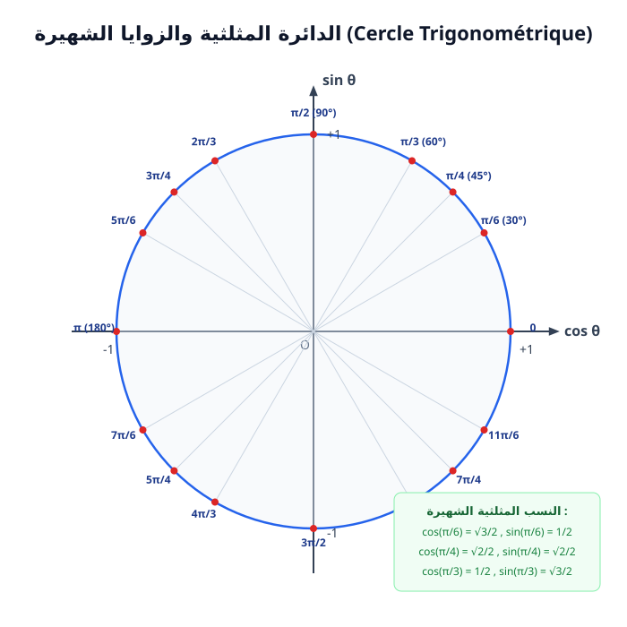

# الزوايا الموجهة وحساب المثلثات

> **التحويل بين الدرجات والراديان:**
> $$\frac{\alpha^\circ}{180} = \frac{x \text{ rad}}{\pi}$$

---

## 1. الدائرة المثلثية وقيم الزوايا الشهيرة

$$\cos^2(x) + \sin^2(x) = 1, \qquad -1 \le \cos(x) \le 1, \qquad -1 \le \sin(x) \le 1$$

| الزاوية $x$ | $0$ | $\dfrac{\pi}{6}$ | $\dfrac{\pi}{4}$ | $\dfrac{\pi}{3}$ | $\dfrac{\pi}{2}$ | $\pi$ |
| :---: | :---: | :---: | :---: | :---: | :---: | :---: |
| $\sin(x)$ | $0$ | $\dfrac{1}{2}$ | $\dfrac{\sqrt{2}}{2}$ | $\dfrac{\sqrt{3}}{2}$ | $1$ | $0$ |
| $\cos(x)$ | $1$ | $\dfrac{\sqrt{3}}{2}$ | $\dfrac{\sqrt{2}}{2}$ | $\dfrac{1}{2}$ | $0$ | $-1$ |

---

## 2. دساتير الإرجاع إلى الربع الأول

> * **الزوايا المتعاكسة ($-x$):**
>   $$\cos(-x) = \cos(x), \qquad \sin(-x) = -\sin(x)$$
> * **الزوايا المتكاملة ($\pi - x$):**
>   $$\cos(\pi - x) = -\cos(x), \qquad \sin(\pi - x) = \sin(x)$$
> * **الزوايا التي فرقها $\pi$ ($\pi + x$):**
>   $$\cos(\pi + x) = -\cos(x), \qquad \sin(\pi + x) = -\sin(x)$$
> * **الزوايا المتتامة ($\frac{\pi}{2} - x$):**
>   $$\cos\left(\frac{\pi}{2} - x\right) = \sin(x), \qquad \sin\left(\frac{\pi}{2} - x\right) = \cos(x)$$

---

## 3. دساتير الجمع والضعف

$$\cos(a + b) = \cos(a)\cos(b) - \sin(a)\sin(b)$$
$$\cos(a - b) = \cos(a)\cos(b) + \sin(a)\sin(b)$$
$$\sin(a + b) = \sin(a)\cos(b) + \cos(a)\sin(b)$$
$$\sin(a - b) = \sin(a)\cos(b) - \cos(a)\sin(b)$$

> **دساتير ضعف الزاوية ($2a$):**
> $$\cos(2a) = \cos^2(a) - \sin^2(a) = 2\cos^2(a) - 1 = 1 - 2\sin^2(a)$$
> $$\sin(2a) = 2\sin(a)\cos(a)$$

---

## 4. حل المعادلات المثلثية في $\mathbb{R}$

* **المعادلة $\cos(x) = \cos(\alpha)$:**
  $$x = \alpha + 2k\pi \quad \text{أو} \quad x = -\alpha + 2k\pi \quad (k \in \mathbb{Z})$$
* **المعادلة $\sin(x) = \sin(\alpha)$:**
  $$x = \alpha + 2k\pi \quad \text{أو} \quad x = (\pi - \alpha) + 2k\pi \quad (k \in \mathbb{Z})$$

---

## 4. بنك التمارين التدريبية (مع الحلول المفصلة)

### 📌 التمرين الأول: المعادلات المثلثية ودساتير التحويل
1. حل في المجال $[0, 2\pi[$ المعادلة المثلثية:
   $$2\cos^2(x) - \cos(x) - 1 = 0$$
2. احسب القيمة المضبوطة لكل من: $\cos\left(\dfrac{7\pi}{12}\right)$ و $\sin\left(\dfrac{7\pi}{12}\right)$ بملاحظة أن:
   $$\dfrac{7\pi}{12} = \dfrac{\pi}{3} + \dfrac{\pi}{4}$$
3. بسط العبارة المثلثية التالية:
   $$A(x) = \cos(x + \pi) + \sin\left(x + \dfrac{\pi}{2}\right) - \cos\left(\dfrac{\pi}{2} - x\right) + \sin(\pi - x)$$

---

### 💡 الحل المفصل للتمرين الأول:
1. **حل المعادلة $2\cos^2(x) - \cos(x) - 1 = 0$:**
   * نضع المجهول المساعد $X = \cos(x)$ مع الشرط $-1 \le X \le 1$.
   * تصبح المعادلة: $2X^2 - X - 1 = 0$.
     $\Delta = (-1)^2 - 4(2)(-1) = 1 + 8 = 9 = 3^2$.
     $$X_1 = \dfrac{1 - 3}{4} = -\dfrac{1}{2} \quad , \quad X_2 = \dfrac{1 + 3}{4} = 1$$
   * نرجع إلى المتغير الأصلي $x \in [0, 2\pi[$:
     * **الحالة 1:** $\cos(x) = 1 \implies x = 0$.
     * **الحالة 2:** $\cos(x) = -\dfrac{1}{2}$:
       نعلم أن $\cos\left(\dfrac{\pi}{3}\right) = \dfrac{1}{2}$، والتجيب سالب في الربعين الثاني والثالث:
       $$x = \pi - \dfrac{\pi}{3} = \dfrac{2\pi}{3} \quad \text{أو} \quad x = \pi + \dfrac{\pi}{3} = \dfrac{4\pi}{3}$$
   * **مجموعة الحلول:** $S = \left\{0, \dfrac{2\pi}{3}, \dfrac{4\pi}{3}\right\}$.

2. **حساب $\cos\left(\dfrac{7\pi}{12}\right)$ باستعمال دساتير الجمع:**
   * $\cos(a + b) = \cos(a)\cos(b) - \sin(a)\sin(b)$.
     $$\cos\left(\dfrac{7\pi}{12}\right) = \cos\left(\dfrac{\pi}{3} + \dfrac{\pi}{4}\right) = \cos\left(\dfrac{\pi}{3}\right)\cos\left(\dfrac{\pi}{4}\right) - \sin\left(\dfrac{\pi}{3}\right)\sin\left(\dfrac{\pi}{4}\right)$$
     $$= \left(\dfrac{1}{2}\right)\left(\dfrac{\sqrt{2}}{2}\right) - \left(\dfrac{\sqrt{3}}{2}\right)\left(\dfrac{\sqrt{2}}{2}\right) = \dfrac{\sqrt{2} - \sqrt{6}}{4}$$
   * $\sin(a + b) = \sin(a)\cos(b) + \cos(a)\sin(b)$.
     $$\sin\left(\dfrac{7\pi}{12}\right) = \sin\left(\dfrac{\pi}{3}\right)\cos\left(\dfrac{\pi}{4}\right) + \cos\left(\dfrac{\pi}{3}\right)\sin\left(\dfrac{\pi}{4}\right) = \dfrac{\sqrt{6} + \sqrt{2}}{4}$$

3. **تبسيط العبارة $A(x)$:**
   باستعمال دساتير الإرجاع إلى الربع الأول:
   * $\cos(x + \pi) = -\cos(x)$
   * $\sin\left(x + \dfrac{\pi}{2}\right) = \cos(x)$
   * $\cos\left(\dfrac{\pi}{2} - x\right) = \sin(x)$
   * $\sin(\pi - x) = \sin(x)$
   نعوض في $A(x)$:
   $$A(x) = [-\cos(x)] + [\cos(x)] - [\sin(x)] + [\sin(x)] = 0$$
