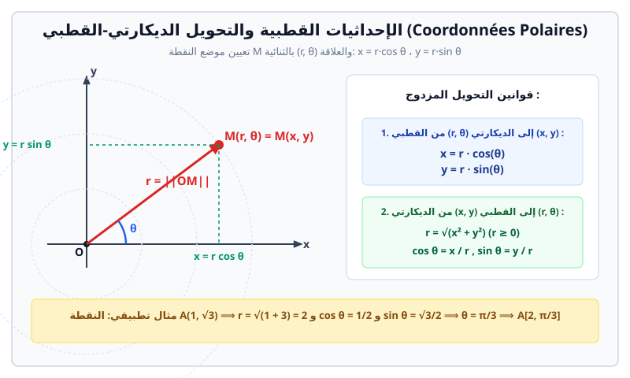

# الإحداثيات القطبية (Coordonnées Polaires)

> **المعلم القطبي (Repère polaire):**  
> يتكون المعلم القطبي من نقطة ثابتة $O$ تُسمى **القطب** (Pôle)، ونصف مستقيم موجه بشعاع وحدة $\vec{u}$ يُسمى **المحور القطبي** (Axe polaire). نرمز للمعلم القطبي بـ $(O; \vec{u})$.

---

## 1. إحداثيات نقطة في المعلم القطبي

لكل نقطة $M$ من المستوي تختلف عن $O$:
* يُعيَّن موضع النقطة $M$ بالثنائية $(r, \theta)$ وتُسمى **الإحداثيات القطبية** للنقطة $M$:
  1. $r = OM$: المسافة بين القطب $O$ والنقطة $M$ (دائماً $r \geq 0$).
  2. $\theta = (\vec{u}, \vec{OM})$: القيس بالراديان للزاوية الموجهة بين المحور القطبي والشعاع $\vec{OM}$ (معرفة بترديد $2\pi$).
* بالنسبة للقطب $O$: $r = 0$ والزاوية $\theta$ غير معينة (تأخذ أي قيمة).
* إذا كان لنقطة $M$ إحداثيان قطبيان $(r, \theta)$، فإن جميع الثنائيات $(r, \theta + 2k\pi)$ حيث $k \in \mathbb{Z}$ تمثل نفس النقطة $M$.
* **الإحداثيات القطبية الرئيسية:** هي الثنائية $(r, \theta)$ حيث $\theta \in ]-\pi, \pi]$ و $r > 0$.

---

## 2. التحويل بين الإحداثيات القطبية والإحداثيات الديكارتية

نربط المعلم القطبي $(O; \vec{u})$ بالمعلم المتعامد والمتجانس المباشر $(O; \vec{i}, \vec{j})$ حيث $\vec{i} = \vec{u}$.

### أ. التحويل من القطبي $(r, \theta)$ إلى الديكارتي $(x, y)$
إذا كانت إحداثيات النقطة $M$ قطبياً هي $(r, \theta)$، فإن إحداثياتها الديكارتية هي:
$$\begin{cases} x = r \cos \theta \\ y = r \sin \theta \end{cases}$$

### ب. التحويل من الديكارتي $(x, y)$ إلى القطبي $(r, \theta)$
إذا كانت إحداثيات النقطة $M(x, y)$ معلومة (مع $(x, y) \neq (0, 0)$):
1. **المسافة $r$:**
   $$r = \sqrt{x^2 + y^2}$$
2. **الزاوية $\theta$:**
   $$\cos \theta = \frac{x}{r} = \frac{x}{\sqrt{x^2 + y^2}} \quad \text{و} \quad \sin \theta = \frac{y}{r} = \frac{y}{\sqrt{x^2 + y^2}}$$
   * نحدد الزاوية $\theta$ بدقة انطلاقاً من قيمتي جيب التمام والجيب وإشارتيهما (الربع المناسب في الدائرة المثلثية).

---

## 3. المعادلات القطبية للأشكال الهندسية الشهيرة

| الشكل الهندسي | المعادلة القطبية | الملاحظات والتفسير الهندسي |
| :--- | :---: | :--- |
| **دائرة مركزها $O$ ونصف قطرها $R$** | $r = R$ | جميع النقاط تبعد بالمسافة الثابتة $R$ عن القطب $O$ مهما كانت الزاوية $\theta$. |
| **نصف مستقيم ينطلق من القطب $O$** | $\theta = \alpha$ | جميع النقاط تشكل زاوية ثابتة $\alpha$ مع المحور القطبي مع $r \geq 0$. |
| **مستقيم يمر بالقطب $O$** | $\theta = \alpha$ أو $\theta = \alpha + \pi$ | يشمل نصفي المستقيم المتعاكسين. |
| **دائرة مارة بالمبدأ مركزها على محور الفواصل $(\frac{a}{2}, 0)$** | $r = a \cos \theta$ | قطرها $a$ على المحور القطبي ($\theta \in [-\frac{\pi}{2}, \frac{\pi}{2}]$). |
| **دائرة مارة بالمبدأ مركزها على محور التراتيب $(0, \frac{b}{2})$** | $r = b \sin \theta$ | قطرها $b$ عمودي على المحور القطبي ($\theta \in [0, \pi]$). |

---

## 4. المسافة بين نقطتين في الإحداثيات القطبية

لتكن النقطتان $A(r_A, \theta_A)$ و $B(r_B, \theta_B)$ في المعلم القطبي. بتطبيق مبرهنة الكاشي في المثلث $OAB$:
$$AB^2 = OA^2 + OB^2 - 2 \cdot OA \cdot OB \cdot \cos(\widehat{AOB})$$
$$AB = \sqrt{r_A^2 + r_B^2 - 2 r_A r_B \cos(\theta_B - \theta_A)}$$

---

## 5. تمارين تطبيقية نموذجية مع الحل المفصل

### تمرين 1: تحويلات الإحداثيات
1. عيّن الإحداثيات الديكارتية للنقاط التالية المعطاة بإحداثياتها القطبية:
   * $A\left(4, \dfrac{\pi}{3}\right)$
   * $B\left(2\sqrt{2}, \dfrac{3\pi}{4}\right)$
   * $C\left(6, -\dfrac{\pi}{2}\right)$
2. عيّن الإحداثيات القطبية الرئيسية للنقاط التالية المعطاة بإحداثياتها الديكارتية:
   * $D(\sqrt{3}, 1)$
   * $E(-2, 2)$
   * $F(0, -5)$

#### الحل المفصل:
1. **التحويل إلى الإحداثيات الديكارتية:**
   * **للنقطة $A$:**
     $$x_A = 4 \cos\left(\frac{\pi}{3}\right) = 4 \times \frac{1}{2} = 2$$
     $$y_A = 4 \sin\left(\frac{\pi}{3}\right) = 4 \times \frac{\sqrt{3}}{2} = 2\sqrt{3}$$
     إذن: $A(2, 2\sqrt{3})$.
   * **للنقطة $B$:**
     $$x_B = 2\sqrt{2} \cos\left(\frac{3\pi}{4}\right) = 2\sqrt{2} \times \left(-\frac{\sqrt{2}}{2}\right) = -2$$
     $$y_B = 2\sqrt{2} \sin\left(\frac{3\pi}{4}\right) = 2\sqrt{2} \times \frac{\sqrt{2}}{2} = 2$$
     إذن: $B(-2, 2)$.
   * **للنقطة $C$:**
     $$x_C = 6 \cos\left(-\frac{\pi}{2}\right) = 6 \times 0 = 0$$
     $$y_C = 6 \sin\left(-\frac{\pi}{2}\right) = 6 \times (-1) = -6$$
     إذن: $C(0, -6)$.

2. **التحويل إلى الإحداثيات القطبية:**
   * **للنقطة $D(\sqrt{3}, 1)$:**
     $$r_D = \sqrt{(\sqrt{3})^2 + 1^2} = \sqrt{3 + 1} = \sqrt{4} = 2$$
     $$\cos \theta_D = \frac{\sqrt{3}}{2}, \quad \sin \theta_D = \frac{1}{2} \quad \Longrightarrow \quad \theta_D = \frac{\pi}{6}$$
     إذن: $D\left(2, \dfrac{\pi}{6}\right)$.
   * **للنقطة $E(-2, 2)$:**
     $$r_E = \sqrt{(-2)^2 + 2^2} = \sqrt{4 + 4} = \sqrt{8} = 2\sqrt{2}$$
     $$\cos \theta_E = \frac{-2}{2\sqrt{2}} = -\frac{\sqrt{2}}{2}, \quad \sin \theta_E = \frac{2}{2\sqrt{2}} = \frac{\sqrt{2}}{2} \quad \Longrightarrow \quad \theta_E = \pi - \frac{\pi}{4} = \frac{3\pi}{4}$$
     إذن: $E\left(2\sqrt{2}, \dfrac{3\pi}{4}\right)$.
   * **للنقطة $F(0, -5)$:**
     $$r_F = \sqrt{0^2 + (-5)^2} = 5$$
     النقطة تقع على الجزء السالب لمحور التراتيب، إذن: $\theta_F = -\dfrac{\pi}{2}$.
     إذن: $F\left(5, -\dfrac{\pi}{2}\right)$.

---

### تمرين 2: حساب المسافات بالمعلم القطبي
لتكن النقطتان $P\left(4, \dfrac{\pi}{6}\right)$ و $Q\left(4, \dfrac{\pi}{2}\right)$ في المعلم القطبي $(O; \vec{u})$.  
1. احسب المسافة $PQ$ مباشرة باستعمال قانون المسافة القطبي.  
2. ما هي طبيعة المثلث $OPQ$؟ علل إجابتك.

#### الحل المفصل:
1. **حساب المسافة $PQ$:**
   $$\theta_Q - \theta_P = \frac{\pi}{2} - \frac{\pi}{6} = \frac{3\pi - \pi}{6} = \frac{2\pi}{6} = \frac{\pi}{3} \ (60^\circ)$$
   بتطبيق صيغة المسافة:
   $$PQ^2 = r_P^2 + r_Q^2 - 2 r_P r_Q \cos\left(\frac{\pi}{3}\right)$$
   $$PQ^2 = 4^2 + 4^2 - 2 \times 4 \times 4 \times \frac{1}{2} = 16 + 16 - 16 = 16$$
   $$PQ = \sqrt{16} = 4$$

2. **طبيعة المثلث $OPQ$:**
   * لدينا $OP = r_P = 4$ و $OQ = r_Q = 4$ ووجدنا $PQ = 4$.
   * بما أن $OP = OQ = PQ = 4$، فإن المثلث $OPQ$ **متساوي الأضلاع** (Equilatéral).
   * زواياه الثلاث متقايسة وتساوي $\dfrac{\pi}{3} \ (60^\circ)$.
