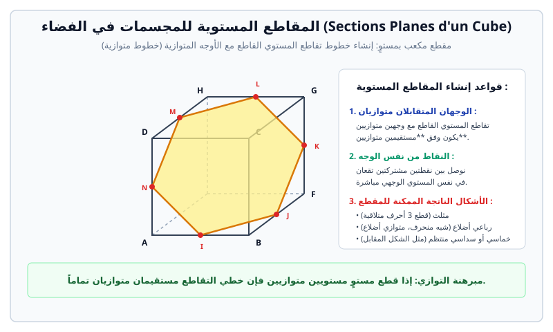

# المقاطع المستوية للمجسمات والأشعة في الفضاء

> **المقطع المستوي لمجسم:**  
> هو تقاطع مجسم في الفضاء (مكعب، رباعي وجوه، موشور...) مع مستوٍ $(\mathcal{P})$. شكل المقطع هو مضلع مستوٍ تقع رؤوسه على أضلاع المجسم أو أحرُفه، وتقع أضلاعه في أوجه المجسم.

---

## 1. الأوضاع النسبية في الفضاء ومبرهنة السقف

### أ. الأوضاع النسبية الأساسية
* **مستقيمان في الفضاء:** إما من نفس المستوي (متقاطعان أو متوازيان)، أو **ليسا من نفس المستوي** (Non coplanaires) حيث لا يتقاطعان ولا يتوازيان.
* **مستقيم ومستوٍ:** إما محتوى في المستوي، أو موازٍ تماماً له، أو قاطع له في نقطة وحيدة.
* **مستويان:** إما متوازيان تماماً (أو منطبقان)، أو متقاطعان وفق **مستقيم**.

### ب. مبرهنة السقف (Théorème du toit)
إذا تقاطع مستويان $(\mathcal{P})$ و $(\mathcal{Q})$ وفق مستقيم $(\Delta)$، وكان المستقيم $(d_1)$ من $(\mathcal{P})$ يوازي المستقيم $(d_2)$ من $(\mathcal{Q})$، فإن:
$$(\Delta) // (d_1) // (d_2)$$
* **خاصية الأوجه المتوازية:** إذا قطع مستوٍ $(\mathcal{P})$ وجهين متوازيين لمجسم (مثلاً قاعدتي مكعب)، فإن خطي تقاطع $(\mathcal{P})$ مع هذين الوجهين هما **مستقيمان متوازيان**.

---

## 2. المقاطع المستوية للمكعب ورباعي الوجوه

### أ. المقاطع الممكنة للمكعب
بما أن للمكعب $6$ أوجه، فإن مقطع المكعب بأي مستوٍ يمكن أن يكون مضلعاً عدد أضلاعه بين $3$ و $6$:
1. **مثلث (Triangle):** إذا قطع المستوي 3 أوجه تلتقي في نفس الرأس (قد يكون متساوي الساقين أو متساوي الأضلاع).
2. **رباعي أضلاع (Quadrilatère):**
   - **مستطيل أو مربع:** مقطع بمستوٍ موازٍ لأحد الأوجه أو مار بقطرين متقابلين.
   - **متوازي أضلاع أو شبه منحرف:** مقطع بمستوٍ يقطع وجهين متقابلين متوازيين.
3. **خماسي (Pentagone):** يقطع 5 أوجه من أوجه المكعب.
4. **سداسي (Hexagone):** يقطع أوجه المكعب الستة جميعها. إذا مر المستوي بمنتصفات أضلاع متعاقبة، يكون المقطع **سداسياً منتظماً**.
* *(مستحيل أن يكون المقطع سباعياً أو أكثر لأن المكعب يملك 6 أوجه فقط).*

### ب. المقاطع الممكنة لرباعي الوجوه (Tétraèdre)
* مثلث (3 أوجه).
* رباعي أضلاع (متوازي أضلاع أو شبه منحرف يقطع الأوجه الأربعة).

---

## 3. الأشعة في الفضاء والارتباط الخطي

تظل جميع خواص الحساب الشعاعي في المستوي (علاقة شال، ضرب شعاع بعدد، مركز الثقل) صالحة كلياً في الفضاء.

### أ. استقامية ثلاث نقاط في الفضاء
تكون النقاط $A, B, C$ في استقامية إذا وفقط إذا وُجد عدد حقيقي $k$ بحيث:
$$\vec{AB} = k \cdot \vec{AC}$$

### ب. الأشعة في نفس المستوي (Vecteurs coplanaires)
لتكن ثلاثة أشعة $\vec{u}, \vec{v}, \vec{w}$ في الفضاء، مع فرض أن $\vec{u}$ و $\vec{v}$ غير مرتبطين خطياً:
> تكون الأشعة $\vec{u}, \vec{v}, \vec{w}$ **في نفس المستوي** إذا وفقط إذا وُجد عددان حقيقيان $\alpha$ و $\beta$ بحيث:
> $$\vec{w} = \alpha \vec{u} + \beta \vec{v}$$

* **أربع نقاط من نفس المستوي:**  
  تكون أربع نقاط $A, B, C, D$ من الفضاء منتمية لنفس المستوي إذا وفقط إذا كانت الأشعة $\vec{AB}, \vec{AC}, \vec{AD}$ في نفس المستوي، أي:
  $$\vec{AD} = \alpha \vec{AB} + \beta \vec{AC}$$

### جـ. المعلم في الفضاء والإحداثيات
يتحدد معلم الفضاء بنقطة أصل $O$ وثلاثة أشعة غير مستوية $(\vec{i}, \vec{j}, \vec{k})$.  
لكل نقطة $M$ ثلاث إحداثيات وحيدة $(x, y, z)$ حيث:
$$\vec{OM} = x \vec{i} + y \vec{j} + z \vec{k}$$

---

## 4. تمارين تطبيقية نموذجية مع الحل المفصل

### تمرين 1: إنشاء مقطع مكعب بمستو
ليكن $ABCDEFGH$ مكعباً طول ضلعه $a$.  
لتكن النقط $I, J, K$ حيث:
* $I$ منتصف $[AB]$
* $J$ منتصف $[AD]$
* $K$ منتصف $[AE]$

1. بيّن أن المستقيم $(IJ)$ يوازي المستوي $(BDE)$.  
2. عيّن خطوط تقاطع المستوي $(IJK)$ مع أوجه المكعب الثلاثة التي تشترك في الرأس $A$.  
3. ما هي طبيعة المضلع الناتج عن مقطع المكعب بالمستوي $(IJK)$؟ احسب أطوال أضلاعه بدلالة $a$.

#### الحل المفصل:
1. **إثبات أن $(IJ) // (BDE)$:**
   * في المثلث $ABD$: النقطة $I$ منتصف $[AB]$ والنقطة $J$ منتصف $[AD]$.
   * بتطبيق نظرية مستقيم المنتصفين في المثلث: $(IJ) // (BD)$.
   * بما أن المستقيم $(BD)$ محتوى في المستوي $(BDE)$ والمستقيم $(IJ)$ غير محتوى فيه، فإن $(IJ)$ يوازي تماماً المستوي $(BDE)$.

2. **تعيين خطوط التقاطع مع الأوجه:**
   * تقاطع $(IJK)$ مع الوجه السفلي $(ABCD)$ هو القطعة $[IJ]$.
   * تقاطع $(IJK)$ مع الوجه الأمامي $(ABFE)$ هو القطعة $[IK]$.
   * تقاطع $(IJK)$ مع الوجه الجانبي الأيسر $(ADHE)$ هو القطعة $[JK]$.

3. **طبيعة المضلع وأطوال أضلاعه:**
   * المقطع هو المثلث $IJK$.
   * نحسب أطوال أضلاعه بتطبيق مبرهنة فيثاغورس في المثلثات القائمة في $A$:
     - في المثلث $AIJ$ القائم في $A$ ($AI = AJ = \frac{a}{2}$):
       $$IJ = \sqrt{AI^2 + AJ^2} = \sqrt{\left(\frac{a}{2}\right)^2 + \left(\frac{a}{2}\right)^2} = \frac{a\sqrt{2}}{2}$$
     - بالمثل في المثلثين القائمين $AIK$ و $AJK$:
       $$IK = \sqrt{AI^2 + AK^2} = \frac{a\sqrt{2}}{2}$$
       $$JK = \sqrt{AJ^2 + AK^2} = \frac{a\sqrt{2}}{2}$$
   * أطوال الأضلاع الثلاثة متساوية ($IJ = IK = JK = \dfrac{a\sqrt{2}}{2}$)، إذن المقطع هو **مثلث متساوي الأضلاع** (Triangle équilatéral).

---

### تمرين 2: إثبات انتماء 4 نقاط لنفس المستوي تحليلياً
في معلم الفضاء $(O; \vec{i}, \vec{j}, \vec{k})$، نعتبر النقاط التالية:
$$A(1, 2, 0), \quad B(2, 3, 1), \quad C(0, 4, -1), \quad D(3, 3, 3)$$
1. احسب مركبات الأشعة $\vec{AB}, \vec{AC}, \vec{AD}$.  
2. هل النقط $A, B, C$ في استقامية؟ علل.  
3. بيّن أن النقاط $A, B, C, D$ تنتمي لنفس المستوي.

#### الحل المفصل:
1. **حساب مركبات الأشعة:**
   $$\vec{AB} = (2-1, 3-2, 1-0) = (1, 1, 1)$$
   $$\vec{AC} = (0-1, 4-2, -1-0) = (-1, 2, -1)$$
   $$\vec{AD} = (3-1, 3-2, 3-0) = (2, 1, 3)$$

2. **استقامية النقط $A, B, C$:**
   * نتحقق من تناسب مركبات $\vec{AB}$ و $\vec{AC}$:
     $$\frac{x_{AC}}{x_{AB}} = \frac{-1}{1} = -1 \quad \text{بينما} \quad \frac{y_{AC}}{y_{AB}} = \frac{2}{1} = 2$$
   * المركبات غير متناسبة ($-1 \neq 2$)، فالشعاعان $\vec{AB}$ و $\vec{AC}$ غير مرتبطين خطياً.
   * إذن النقاط $A, B, C$ ليست في استقامية، وبالتالي فهي تعيّن مستوياً وحيداً $(ABC)$.

3. **إثبات أن $A, B, C, D$ في نفس المستوي:**
   * نبحث عن عددين حقيقيين $\alpha$ و $\beta$ بحيث: $\vec{AD} = \alpha \vec{AB} + \beta \vec{AC}$.
   * نكتب جملة المعادلات التحليلية:
     $$\begin{cases}
     1\alpha - 1\beta = 2 & (1) \\
     1\alpha + 2\beta = 1 & (2) \\
     1\alpha - 1\beta = 3 & (3)
     \end{cases}$$
   * بمقارنة المعادلة (1) والمعادلة (3):
     - المعادلة (1) تعطي: $\alpha - \beta = 2$
     - المعادلة (3) تعطي: $\alpha - \beta = 3$
   * هذا تناقض مستحيل ($2 = 3$)!
   * إذن الجملة لا تقبل حلاً، ولا توجد قيم لـ $\alpha$ و $\beta$ تحقق المساواة.
   * **النتيجة:** الأشعة $\vec{AB}, \vec{AC}, \vec{AD}$ ليست في نفس المستوي، وبالتالي النقاط $A, B, C, D$ **لا تنتمي لنفس المستوي** (ليست مستوية)، وتشكل رؤوس رباعي وجوه $ABCD$.
