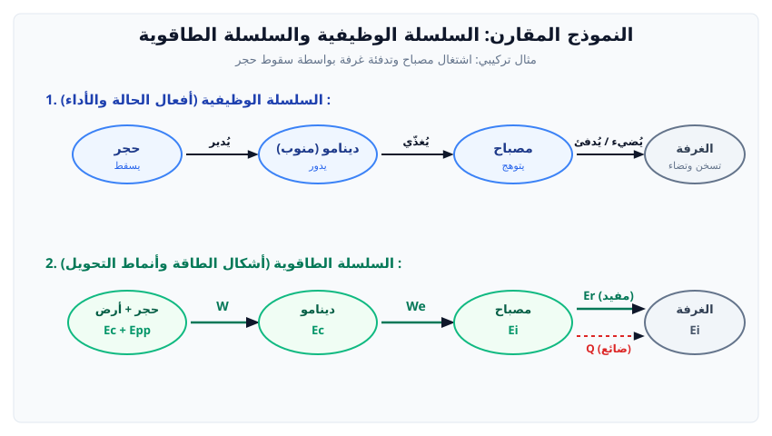
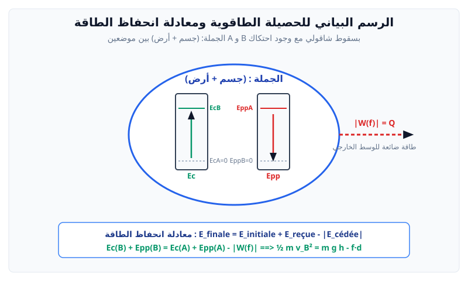

# مقاربة كيفية لطاقة جملة وانحفاظها

> **مفهوم الجملة:**  
> الجملة الميكانيكية هي جسم أو مجموعة من الأجسام نختارها قصد دراستها، وكل ما هو خارج حدود هذه الجملة يُعتبر **وسطاً خارجياً**.

---

## 1. أشكال الطاقة (Formes d'énergie)

تُخزن الجمل الطاقة على شكلين: عياني ومجهري:

| المستوى | شكل الطاقة | الرمز | التعريف والشرط |
| :--- | :--- | :---: | :--- |
| **عياني (Macroscopique)** | **طاقة حركية** | $E_c$ | تتعلق بحركة الجملة وسرعتها ($v > 0$) |
| **عياني** | **طاقة كامنة ثقالية** | $E_{pp}$ | تتعلق بوضع الجملة بالنسبة للأرض وارتفاعها $h$ |
| **عياني** | **طاقة كامنة مرونية** | $E_{pe}$ | تتعلق بتشوه جسم مرن (نابض، مطاط) واستطالته $x$ |
| **مجهري (Microscopique)** | **طاقة داخلية** | $E_i$ | تتعلق بالحالة المجهرية (حرارية، كيميائية، نووية) |

---

## 2. أنماط تحويل الطاقة (Modes de transfert)

تتبادل الجملة الطاقة مع الوسط الخارجي عبر أربعة أنماط:

> 1. **تحويل ميكانيكي ($W$):** يحدث عند تطبيق قوة تؤدي إلى تحريك نقطة تأثيرها.
> 2. **تحويل كهربائي ($W_e$):** يحدث بمرور تيار كهربائي عبر دارة كهربائية.
> 3. **تحويل حراري ($Q$):** يحدث بين جسمين مختلفين في درجتي الحرارة بفعل التلامس أو الحمل أو الإشعاع.
> 4. **تحويل إشعاعي ($E_r$):** يحدث بواسطة موجات كهرومغناطيسية (مثل الضوء).

---

## 3. السلسلة الوظيفية والسلسلة الطاقوية

* **السلسلة الوظيفية:**  
  $$\text{[الجملة 1]} \xrightarrow{\text{فعل أداء}} \text{[الجملة 2]} \xrightarrow{\text{فعل أداء}} \text{[الجملة 3]}$$
  (أسفل الفقاعة: فعل حالة، وفوق السهم: فعل أداء).
* **السلسلة الطاقوية:**  
  $$\text{[الجملة 1]} \xrightarrow{W / W_e / Q / E_r} \text{[الجملة 2]}$$
  (أسفل الفقاعة: شكل الطاقة المخزنة $E_c / E_p / E_i$، وفوق السهم: نمط التحويل).

---

## 4. الحصيلة الطاقوية ومعادلة انحفاظ الطاقة

> **مبدأ انحفاظ الطاقة:**  
> الطاقة لا تستحدث ولا تزول؛ إذا اكتسبت جملة طاقة أو فقدتها، فإنها تكون بالضرورة قد أخذتها من جملة أخرى أو قدمتها لها.

### معادلة انحفاظ الطاقة:
$$E_{\text{finale}} = E_{\text{initiale}} + E_{\text{reçue}} - |E_{\text{cédée}}|$$

* **الجملة المعزولة طاقوياً:** هي جملة لا تتبادل أي طاقة مع الوسط الخارجي ($E_{\text{reçue}} = 0$ و $E_{\text{cédée}} = 0$):
  $$E_{\text{finale}} = E_{\text{initiale}}$$

---

## 5. بنك التمارين التدريبية والنموذجية (مع الحلول المفصلة)

### 📌 التمرين الأول: السلاسل الطاقوية والحصيلة الطاقوية ومعادلة الانحفاظ
نعتبر التجهيز التجريبي التالي:
ينزلق جسم صلب $(S)$ كتلته $m = 200 \text{ g}$ انطلاقاً من السكون من أعلى مستوٍ مائل $A$ إلى أسفله $B$، ثم يصطدم بنابض مرن فيضغطه حتى يتوقف عند الموضع $C$.
نعتبر قوة الاحتكاك مهملة على المسار.
1. مثّل السلسلة الوظيفية ثم السلسلة الطاقوية للجملة في المرحلة بين $A$ و $B$.
2. حدد أشكال الطاقة المخزنة للجمل المختلفة التالية بين $A$ و $B$:
   * الجملة: (جسم).
   * الجملة: (جسم + أرض).
3. أنشئ الحصيلة الطاقوية للجملة (جسم + أرض) بين $A$ و $B$، واكتب معادلة انحفاظ الطاقة الموافقة.
4. أنشئ الحصيلة الطاقوية للجملة (جسم + نابض + أرض) بين $B$ و $C$، واكتب معادلة انحفاظ الطاقة الموافقة.

---

### 💡 الحل المفصل للتمرين الأول:
1. **السلسلة الوظيفية والسلسلة الطاقوية:**
   * **السلسلة الوظيفية:**
     $$\text{[جسم]} \xrightarrow{\text{يشد / يضغط}} \text{[نابض]}$$
     (فعل حالة الجسم: ينزلق / يتباطأ؛ فعل حالة النابض: ينضغط).
   * **السلسلة الطاقوية:**
     $$\text{[جسم + أرض]} \xrightarrow{W} \text{[نابض]}$$
     (طاقة الجسم والأرض: $E_c + E_{pp}$، نمط التحويل ميكانيكي $W$، وطاقة النابض كامنة مرونية $E_{pe}$).

2. **أشكال الطاقة المخزنة حسب اختيار الجملة:**
   * **إذا كانت الجملة (جسم فقط):**
     * الطاقة المخزنة هي طاقة حركية فقط $E_c$ تتعلق بسرعته.
     * الثقل يُعتبر قوة خارجية تقدم تحويلاً ميكانيكياً $W(\vec{P})$.
   * **إذا كانت الجملة (جسم + أرض):**
     * الطاقة المخزنة تشمل طاقة حركية $E_c$ وطاقة كامنة ثقالية $E_{pp}$.
     * الثقل قوة داخلية في الجملة ولا يُحسب كعمل خارجي.

3. **الحصيلة الطاقوية للجملة (جسم + أرض) بين $A$ و $B$:**
   * **الفقاعة:** تتضمن عمودين:
     * عمود الطاقة الكامنة الثقالية $E_{pp}$: يتناقص بسهم نازل من $E_{pp}(A)$ إلى $E_{pp}(B) = 0$ (باعتبار المستوى الأفقي المار بـ $B$ مرجعاً).
     * عمود الطاقة الحركية $E_c$: يتزايد بسهم صاعد من $E_c(A) = 0$ (انطلق من السكون) إلى $E_c(B)$.
   * لا يوجد تبادل طاقوي مع الوسط الخارجي (احتكاك مهمل) $\implies$ الجملة معزولة طاقوياً.
   * **معادلة انحفاظ الطاقة:**
     $$E_{\text{finale}} = E_{\text{initiale}}$$
     $$E_c(B) + E_{pp}(B) = E_c(A) + E_{pp}(A)$$
     $$\dfrac{1}{2} m v_B^2 + 0 = 0 + m g h \implies \dfrac{1}{2} m v_B^2 = m g h$$

4. **الحصيلة الطاقوية للجملة (جسم + نابض + أرض) بين $B$ و $C$:**
   * على مسار أفقي: الارتفاع ثابت $h = 0 \implies \Delta E_{pp} = 0$.
   * يتوقف الجسم عند $C \implies E_c(C) = 0$.
   * عمود الطاقة الحركية $E_c$ يتناقص من $E_c(B)$ إلى $0$.
   * عمود الطاقة الكامنة المرونية للنابض $E_{pe}$ يتزايد من $E_{pe}(B) = 0$ إلى القيمة العظمى $E_{pe}(C) = \dfrac{1}{2} k X_{\max}^2$.
   * **معادلة انحفاظ الطاقة:**
     $$E_c(C) + E_{pe}(C) = E_c(B) + E_{pe}(B)$$
     $$0 + \dfrac{1}{2} k X_{\max}^2 = \dfrac{1}{2} m v_B^2 + 0 \implies \dfrac{1}{2} k X_{\max}^2 = \dfrac{1}{2} m v_B^2$$
