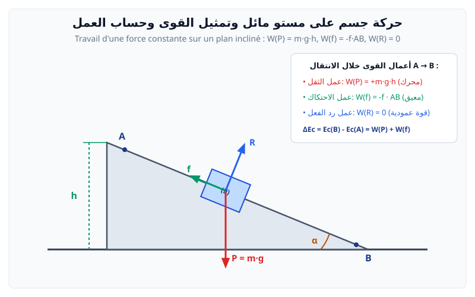

# العمل والطاقة الحركية (حركة انسحابية)

---

## 1. عمل قوة ثابتة في حركة انسحابية

> **تعريف:**  
> عمل قوة ثابتة $\vec{F}$ تنتقل نقطة تأثيرها من الموضع $A$ إلى الموضع $B$ هو الجداء السلمي لشعاع القوة وشعاع الانتقال:
> $$W_{AB}(\vec{F}) = \vec{F} \cdot \vec{AB} = F \cdot AB \cdot \cos(\alpha)$$
> حيث:
> * $W_{AB}(\vec{F})$: العمل بالجول ($\text{J}$).
> * $F$: شدة القوة بالنيوتن ($\text{N}$).
> * $AB$: طول المسار بالمتر ($\text{m}$).
> * $\alpha$: الزاوية المحصورة بين شعاع القوة وشعاع الانتقال $(\vec{F}, \vec{AB})$.

### طبيعة العمل حسب الزاوية $\alpha$:
* $0 \le \alpha < 90^\circ \implies \cos(\alpha) > 0 \implies W > 0$: **عمل محرك**.
* $\alpha = 90^\circ \implies \cos(\alpha) = 0 \implies W = 0$: **عمل معدوم** (مثل قوة الثقل ورد الفعل على مسار أفقي).
* $90^\circ < \alpha \le 180^\circ \implies \cos(\alpha) < 0 \implies W < 0$: **عمل مقاوم** (مثل قوة الاحتكاك $f$).

---

## 2. عمل قوة الثقل ($\vec{P}$) وعمل قوة الاحتكاك ($f$)

* **عمل قوة الثقل:**
  $$W_{AB}(\vec{P}) = \pm m \cdot g \cdot h$$
  * $+ m g h$: في حالة النزول (محرك).
  * $- m g h$: في حالة الصعود (مقاوم).
  * لا يتعلق بالمسار المتبع، بل فقط بالارتفاع الشاقولي $h = |z_A - z_B|$.
* **عمل قوة الاحتكاك المعيقة للحركة ($f$):**
  $$W_{AB}(\vec{f}) = - f \cdot AB$$

---

## 3. عبارة الطاقة الحركية ومبرهنة الطاقة الحركية

> **عبارة الطاقة الحركية لجسم كتلته $m$ يتحرك بسرعة $v$:**
> $$E_c = \frac{1}{2} m v^2$$

> **مبرهنة الطاقة الحركية (Théorème de l'énergie cinétique):**  
> التغير في الطاقة الحركية لجسم صلب في حركة انسحابية بين موضعين $A$ و $B$ يساوي المجموع الجبري لأعمال كل القوى الخارجية المؤثرة عليه:
> $$\Delta E_c = E_{c}(B) - E_{c}(A) = \sum W_{AB}(\vec{F}_{\text{ext}})$$
> $$\frac{1}{2} m v_B^2 - \frac{1}{2} m v_A^2 = W_{AB}(\vec{P}) + W_{AB}(\vec{R}) + W_{AB}(\vec{F}) + W_{AB}(\vec{f})$$

---

## 4. بنك التمارين والمسائل النموذجية الشاملة (مع الحلول المفصلة)

### 📌 التمرين الأول: حركة على مستوٍ مائل وأفقي مع وجود قوى الاحتكاك (مسألة شاملة)
ينزلق جسم صلب $(S)$ كتلته $m = 500 \text{ g}$ على مسار يتكون من جزأين:
* الجزء الأول $AB$: مستوٍ مائل بزاوية $\alpha = 30^\circ$ عن الأفق، طوله $AB = 2 \text{ m}$.
  يخضع الجسم على هذا الجزء لقوة احتكاك ثابتة شدتها $f = 0.5 \text{ N}$.
  ينطلق الجسم من النقطة $A$ بدون سرعة ابتدائية ($v_A = 0$).
* الجزء الثاني $BC$: مستوٍ أفقي خشن حيث قوة الاحتكاك شدتها $f' = 1 \text{ N}$.
  يواصل الجسم حركته حتى يتوقف في النقطة $C$.
* يُعطى: $g = 9.8 \text{ N/kg}$ (أو $10 \text{ N/kg}$). نأخذ $g = 9.8 \text{ m/s}^2$.

1. احسب عمل قوة الثقل $W_{AB}(\vec{P})$ وعمل قوة الاحتكاك $W_{AB}(\vec{f})$ أثناء الانتقال من $A$ إلى $B$.
2. بتطبيق مبرهنة الطاقة الحركية على الجملة (جسم) بين $A$ و $B$، احسب سرعة الجسم عند وصوله إلى النقطة $B$.
3. احسب المسافة $BC$ التي يقطعها الجسم على المستوي الأفقي قبل أن يتوقف تماماً عند $C$.

---

### 💡 الحل المفصل للتمرين الأول:
1. **حساب أعمال القوى بين $A$ و $B$:**
   * الارتفاع الشاقولي $h$: من المثلث القائم:
     $$h = AB \cdot \sin(\alpha) = 2 \cdot \sin(30^\circ) = 2 \times 0.5 = 1 \text{ m}$$
   * **عمل قوة الثقل $W_{AB}(\vec{P})$:**
     بما أن الحركة نزول، فالعمل محرك وموجب:
     $$W_{AB}(\vec{P}) = + m g h = (0.5 \text{ kg}) \times (9.8 \text{ m/s}^2) \times (1 \text{ m}) = 4.9 \text{ J}$$
   * **عمل قوة رد الفعل $W_{AB}(\vec{R})$:**
     بما أن رد فعل السطح $\vec{R}$ عمودي على المسار في كل لحظة ($\cos 90^\circ = 0$):
     $$W_{AB}(\vec{R}) = 0 \text{ J}$$
   * **عمل قوة الاحتكاك $W_{AB}(\vec{f})$:**
     قوة الاحتكاك معاكسة لجهة الحركة ($\alpha = 180^\circ$):
     $$W_{AB}(\vec{f}) = - f \cdot AB = - 0.5 \times 2 = -1.0 \text{ J}$$

2. **تطبيق مبرهنة الطاقة الحركية بين $A$ و $B$:**
   $$\Delta E_c = E_c(B) - E_c(A) = \sum W_{AB}(\vec{F}_{\text{ext}})$$
   $$\dfrac{1}{2} m v_B^2 - 0 = W_{AB}(\vec{P}) + W_{AB}(\vec{R}) + W_{AB}(\vec{f})$$
   $$\dfrac{1}{2} (0.5) v_B^2 = 4.9 + 0 - 1.0 = 3.9 \text{ J}$$
   $$0.25 v_B^2 = 3.9 \implies v_B^2 = \dfrac{3.9}{0.25} = 15.6$$
   $$v_B = \sqrt{15.6} \approx 3.95 \text{ m/s}$$

3. **حساب المسافة $BC$ على المستوي الأفقي:**
   * القوى المؤثرة على المستوي الأفقي: الثقل $\vec{P}$ (عمودي)، رد الفعل $\vec{R}'$ (عمودي ومساوي للثقل)، وقوة الاحتكاك $\vec{f}'$.
   * $W_{BC}(\vec{P}) = 0$ و $W_{BC}(\vec{R}') = 0$.
   * $W_{BC}(\vec{f}') = - f' \cdot BC$.
   * نطبق مبرهنة الطاقة الحركية بين $B$ و $C$ (حيث يتوقف الجسم $v_C = 0$):
     $$E_c(C) - E_c(B) = W_{BC}(\vec{f}')$$
     $$0 - \dfrac{1}{2} m v_B^2 = - f' \cdot BC$$
     $$\dfrac{1}{2} m v_B^2 = f' \cdot BC \implies 3.9 = 1.0 \times BC \implies BC = 3.9 \text{ m}$$
   * المسافة المقطوعة هي **$BC = 3.9 \text{ m}$**.
