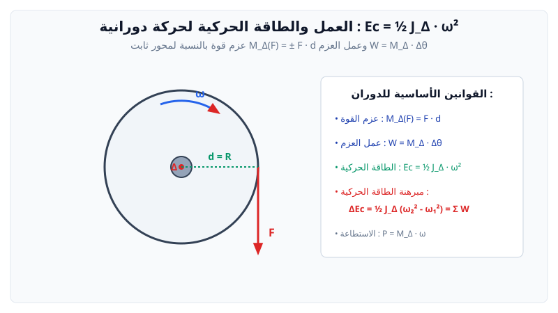

# العمل والطاقة الحركية (حركة دورانية)

> **عزم قوة بالنسبة لمحور دوران ثابت $(\Delta)$:**
> $$M_\Delta(\vec{F}) = \pm F \cdot d$$
> حيث $d$ هو البعد العمودي بين خط فعل القوة ومحور الدوران ($\text{m}$)، و $M_\Delta$ يقاس بـ ($\text{N}\cdot\text{m}$).

---

## 1. عمل عزم قوة أثناء الدوران

عمل عزم قوة ثابتة تدير جسماً صلباً بزاوية $\theta$ (بالراديان):
$$W(\vec{F}) = M_\Delta(\vec{F}) \cdot \theta$$
* إذا دار الجسم $n$ دورة: $\theta = 2\pi n$.

---

## 2. الطاقة الحركية لجسم صلب في دوران حول محور ثابت

$$E_c = \frac{1}{2} J_\Delta \omega^2$$
حيث:
* $J_\Delta$: عزم عطالة الجسم الصلب بالنسبة لمحور الدوران ($\text{kg}\cdot\text{m}^2$).
* $\omega$: السرعة الزاوية بالراديان على الثانية ($\text{rad/s}$).
* العلاقة بين السرعة الخطية والسرعة الزاوية لنقطة تبعد مسافة $R$ عن المحور: $v = R \cdot \omega$.

---

## 3. جدول عزوم العطالة للأجسام المتجانسة المألوفة ومبرهنة هايغنز (Huygens)

### أ. عزوم العطالة لأجسام متجانسة بالنسبة لمحور يمر بمركز عطالتها $G$:

| الجسم الصلب | شكل وتمركز محور الدوران $(\Delta)$ | عبارة عزم العطالة $J_G$ |
| :--- | :--- | :---: |
| **أسطوانة ممتلئة (أو قرص دائري)** | محور تناظر الأسطوانة (أو عمودي على القرص في مركزه) | $J_G = \dfrac{1}{2} M R^2$ |
| **أسطوانة مجوفة (حلقة رقيقة)** | محور التناظر الأسطواني | $J_G = M R^2$ |
| **ساق مستقيمة مهملة السمك طولها $L$** | محور عمودي على الساق يمر بمركزها $G$ | $J_G = \dfrac{1}{12} M L^2$ |
| **كرة ممتلئة مصمتة نصف قطرها $R$** | محور مار بأي قطر من أقطار الكرة | $J_G = \dfrac{2}{5} M R^2$ |
| **قشرة كروية مجوفة رقيقة** | محور مار بأحد أقطارها | $J_G = \dfrac{2}{3} M R^2$ |

### ب. مبرهنة هايغنز (Théorème de Huygens / مبرهنة المحاور المتوازية)
إذا كان $(\Delta)$ محورا يوازي المحور المار بمركز العطالة $(\Delta_G)$ ويبعد عنه بمسافة $d$:
$$J_\Delta = J_G + M \cdot d^2$$
* **مثال هام:** عزم عطالة ساق طولها $L$ بالنسبة لمحور عمودي يمر بأحد طرفيها ($d = \frac{L}{2}$):
  $$J_\Delta = \frac{1}{12} M L^2 + M \left(\frac{L}{2}\right)^2 = \frac{1}{12} M L^2 + \frac{1}{4} M L^2 = \frac{1}{3} M L^2$$

---

## 4. مبرهنة الطاقة الحركية في الحركة الدورانية

$$\Delta E_c = E_c(B) - E_c(A) = \frac{1}{2} J_\Delta \omega_B^2 - \frac{1}{2} J_\Delta \omega_A^2 = \sum W_{A \to B}(\vec{F}_{\text{ext}})$$

---

## 5. بنك التمارين والمسائل التدريبية (مع الحلول المفصلة)

### 📌 التمرين الأول: دوران أسطوانة وعزم العطالة ومبرهنة الطاقة الحركية
نعتبر أسطوانة متجانسة كتلتها $M = 2 \text{ kg}$ ونصف قطرها $R = 10 \text{ cm} = 0.1 \text{ m}$، قابلة للدوران حول محور ثابت أفقي $(\Delta)$ يمر بمركز عطالتها.
عزم عطالة الأسطوانة يُعطى بالعلاقة: $J_\Delta = \dfrac{1}{2} M R^2$.
نلف حول الأسطوانة خيطاً مهملاً الكتلة وعديم الامتطاط، ونعلق بطرفه الحر جسماً صلباً $(m)$ كتلته $m = 400 \text{ g} = 0.4 \text{ kg}$.
نترك الجملة لحالها دون سرعة ابتدائية، فيهبط الجسم مسافة $h = 1.5 \text{ m}$. نأخذ $g = 10 \text{ m/s}^2$ ونهمل الاحتكاكات.

1. احسب عزم عطالة الأسطوانة $J_\Delta$.
2. بتطبيق مبرهنة الطاقة الحركية على الجملة المركبة (أسطوانة + جسم)، احسب السرعة الخطية $v$ للجسم $(m)$ عند قطعه المسافة $h$.
3. استنتج السرعة الزاوية $\omega$ للأسطوانة عند تلك اللحظة.
4. احسب الاستطاعة اللحظية التي يقدمها ثقل الجسم عند تلك اللحظة.

---

### 💡 الحل المفصل للتمرين الأول:
1. **حساب عزم عطالة الأسطوانة $J_\Delta$:**
   $$J_\Delta = \dfrac{1}{2} M R^2 = \dfrac{1}{2} \times 2 \times (0.1)^2 = 0.01 \text{ kg}\cdot\text{m}^2$$

2. **حساب سرعة الجسم $v$ بواسطة مبرهنة الطاقة الحركية:**
   * الطاقة الحركية للجملة المركبة هي مجموع الطاقة الحركية الانسحابية للجسم والطاقة الحركية الدورانية للأسطوانة:
     $$E_c = E_{c,\text{trans}} + E_{c,\text{rot}} = \dfrac{1}{2} m v^2 + \dfrac{1}{2} J_\Delta \omega^2$$
   * بما أن الخيط لا ينزلق على الأسطوانة، فإن السرعة الخطية ترتبط بالسرعة الزاوية بالعلاقة: $v = R \omega \iff \omega = \dfrac{v}{R}$.
   * نعوض:
     $$\dfrac{1}{2} J_\Delta \omega^2 = \dfrac{1}{2} \left(\dfrac{1}{2} M R^2\right) \left(\dfrac{v}{R}\right)^2 = \dfrac{1}{4} M v^2$$
   * إذن الطاقة الحركية الإجمالية للجملة:
     $$E_c = \dfrac{1}{2} m v^2 + \dfrac{1}{4} M v^2 = \left(\dfrac{1}{2} m + \dfrac{1}{4} M\right) v^2$$
     $$\left(\dfrac{1}{2}(0.4) + \dfrac{1}{4}(2)\right) v^2 = (0.2 + 0.5) v^2 = 0.7 v^2$$
   * القوة الخارجية الوحيدة التي تنجز عملاً مفيداً للجملة هي ثقل الجسم $m$:
     $$W(\vec{P}) = m g h = 0.4 \times 10 \times 1.5 = 6 \text{ J}$$
   * مبرهنة الطاقة الحركية:
     $$E_c(\text{final}) - 0 = W(\vec{P}) \iff 0.7 v^2 = 6 \iff v^2 = \dfrac{6}{0.7} \approx 8.57$$
     $$v = \sqrt{8.57} \approx 2.93 \text{ m/s}$$

3. **استنتاج السرعة الزاوية للأسطوانة $\omega$:**
   $$\omega = \dfrac{v}{R} = \dfrac{2.93}{0.1} = 29.3 \text{ rad/s}$$

4. **الاستطاعة اللحظية $P$ لثقل الجسم:**
   $$P = \vec{P} \cdot \vec{v} = P \cdot v = m g v = (0.4 \times 10) \times 2.93 = 4 \times 2.93 = 11.72 \text{ W}$$
