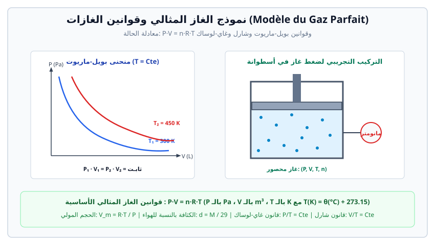

# نموذج الغاز المثالي وقوانين الغازات (Modèle du Gaz Parfait)

> **الغاز المثالي (Gaz Parfait):**  
> هو نموذج نظري لغاز حقيقي عند ضغوط منخفضة ودرجات حرارة مرتفعة نسبياً، يُهمل فيه الحجم الخاص بالجزيئات أمام حجم الوعاء الذي يشغله الغاز، وتُهمل فيه قوى التأثير المتبادل بين جزيئاته إلا أثناء التصادمات المرنة فيما بينها ومع جدران الوعاء.

---

## 1. المقادير الترموديناميكية المميزة لحالة غاز

تُوصف حالة كمية معينة من الغاز بواسطة أربعة متغيرات فيزيائية:

| المقدار الفيزيائي | الرمز | الوحدة في الجملة الدولية (SI) | وحدات شائعة أخرى والتحويلات |
| :--- | :---: | :---: | :--- |
| **الضغط (Pression)** | $P$ | الباسكال ($\text{Pa}$) | $1 \text{ bar} = 10^5 \text{ Pa}$ $1 \text{ atm} = 1.013 \times 10^5 \text{ Pa} = 760 \text{ mmHg}$ |
| **الحجم (Volume)** | $V$ | المتر المكعب ($\text{m}^3$) | $1 \text{ L} = 1 \text{ dm}^3 = 10^{-3} \text{ m}^3$ $1 \text{ mL} = 1 \text{ cm}^3 = 10^{-6} \text{ m}^3$ |
| **درجة الحرارة المطلقة (Température)** | $T$ | الكلفن ($\text{K}$) | $T(\text{K}) = \theta(^\circ\text{C}) + 273.15$ |
| **كمية المادة (Quantité de matière)** | $n$ | المول ($\text{mol}$) | $n = \dfrac{m}{M} = \dfrac{V}{V_m} = \dfrac{N}{N_A}$ |

---

## 2. القوانين التجريبية للغازات (Lois empiriques)

### أ. قانون بويل - ماريوط (Loi de Boyle-Mariotte)
عند ثبوت درجة الحرارة ($T = \text{cte}$) وكمية المادة ($n = \text{cte}$)، يتناسب حجم الغاز عكساً مع ضغطه:
$$P \cdot V = \text{cte} \quad \Longleftrightarrow \quad P_1 \cdot V_1 = P_2 \cdot V_2$$

### ب. قانون شارل (Loi de Charles)
عند ثبوت الضغط ($P = \text{cte}$) وكمية المادة ($n = \text{cte}$)، يتناسب حجم الغاز طرداً مع درجة حرارته المطلقة:
$$\frac{V}{T} = \text{cte} \quad \Longleftrightarrow \quad \frac{V_1}{T_1} = \frac{V_2}{T_2}$$

### جـ. قانون غاي - لوساك (Loi de Gay-Lussac)
عند ثبوت الحجم ($V = \text{cte}$) وكمية المادة ($n = \text{cte}$)، يتناسب ضغط الغاز طرداً مع درجة حرارته المطلقة:
$$\frac{P}{T} = \text{cte} \quad \Longleftrightarrow \quad \frac{P_1}{T_1} = \frac{P_2}{T_2}$$

### د. قانون أفوجادرو - أمبير (Loi d'Avogadro-Ampère)
تحت نفس شروط الضغط $P$ ودرجة الحرارة $T$، تحتوي الحجوم المتساوية من الغازات المختلفة على نفس عدد الجزيئات (وبالتالي نفس كمية المادة $n$):
$$\frac{V}{n} = V_m = \text{cte}$$

---

## 3. معادلة الحالة للغاز المثالي (Équation d'état)

تجمع معادلة الحالة القوانين السابقة في علاقة واحدة عامة:
$$P \cdot V = n \cdot R \cdot T$$
* $P$: ضغط الغاز بالباسكال ($\text{Pa}$).
* $V$: حجم الغاز بالمتر المكعب ($\text{m}^3$).
* $n$: كمية مادة الغاز بالمول ($\text{mol}$).
* $R$: ثابت الغازات المثالية العام:
  $$R \approx 8.314 \text{ J}\cdot\text{mol}^{-1}\cdot\text{K}^{-1}$$
* $T$: درجة الحرارة المطلقة بالكلفن ($\text{K}$).

---

## 4. الحجم المولي والكثافة بالنسبة للهواء

### أ. الحجم المولي ($V_m$)
هو الحجم الذي يشغله مول واحد من الغاز تحت شروط محددة من الضغط والحرارة:
$$V_m = \frac{R \cdot T}{P}$$
* **في الشروط النظامية (C.T.P: $T = 0^\circ\text{C} = 273.15 \text{ K}$, $P = 1 \text{ atm} = 1.013 \times 10^5 \text{ Pa}$):**
  $$V_m = \frac{8.314 \times 273.15}{1.013 \times 10^5} \approx 22.414 \times 10^{-3} \text{ m}^3/\text{mol} = 22.4 \text{ L/mol}$$
* **في الشروط المعيارية ($T = 20^\circ\text{C}$ أو $25^\circ\text{C}$ عند $P = 1 \text{ bar}$):**
  $$V_m \approx 24.8 \text{ L/mol}$$

### ب. كثافة غاز بالنسبة للهواء ($d$)
$$d = \frac{\rho_{\text{gaz}}}{\rho_{\text{air}}} = \frac{M_{\text{gaz}}}{M_{\text{air}}}$$
بما أن الكتلة المولية المتوسطة للهواء هي $M_{\text{air}} \approx 29 \text{ g/mol}$ (حيث يتكون الهواء من $80\% \text{ N}_2$ و $20\% \text{ O}_2$ تقريباً: $0.8 \times 28 + 0.2 \times 32 = 28.8 \approx 29 \text{ g/mol}$):
$$d = \frac{M}{29}$$

---

## 5. تمارين تطبيقية نموذجية مع الحل المفصل

### تمرين 1: تطبيق مباشر لمعادلة الحالة
قارورة حجمها $V = 10 \text{ L}$ تحتوي على غاز ثنائي الأكسجين $\text{O}_2$ كتلته $m = 64 \text{ g}$ عند درجة حرارة $\theta = 27^\circ\text{C}$.  
1. احسب كمية مادة الغاز $n$.  
2. احسب ضغط الغاز داخل القارورة بالباسكال وبـ $\text{bar}$.  
3. ما هي كثافة غاز ثنائي الأكسجين بالنسبة للهواء؟  
*(المعطيات: $M(\text{O}) = 16 \text{ g/mol}$، $R = 8.314 \text{ J}\cdot\text{mol}^{-1}\cdot\text{K}^{-1}$)*

#### الحل المفصل:
1. **حساب كمية المادة $n$:**
   $$M(\text{O}_2) = 2 \times 16 = 32 \text{ g/mol}$$
   $$n = \frac{m}{M} = \frac{64}{32} = 2.0 \text{ mol}$$

2. **حساب الضغط $P$:**
   * الحجم: $V = 10 \text{ L} = 10 \times 10^{-3} \text{ m}^3 = 10^{-2} \text{ m}^3$
   * درجة الحرارة المطلقة: $T = 27 + 273.15 = 300.15 \text{ K}$
   * من معادلة الغاز المثالي:
     $$P = \frac{n R T}{V} = \frac{2.0 \times 8.314 \times 300.15}{10^{-2}} \approx \frac{4990.89}{0.01} = 4.99 \times 10^5 \text{ Pa}$$
   * بالبار:
     $$P = \frac{4.99 \times 10^5}{10^5} = 4.99 \text{ bar} \approx 5 \text{ bar}$$

3. **حساب الكثافة بالنسبة للهواء:**
   $$d = \frac{M}{29} = \frac{32}{29} \approx 1.10$$
   بما أن $d > 1$ فإن غاز ثنائي الأكسجين أثقل من الهواء.

---

### تمرين 2: انضغاط غاز مع تغير درجة الحرارة
كمية من غاز مثالي تشغل حجماً $V_1 = 4.5 \text{ L}$ تحت ضغط $P_1 = 1.0 \times 10^5 \text{ Pa}$ ودرجة حرارة $T_1 = 293 \text{ K}$ ($20^\circ\text{C}$). نقوم بضغط الغاز حتى يصبح حجمه $V_2 = 1.5 \text{ L}$ وترتفع درجة حرارته إلى $T_2 = 333 \text{ K}$ ($60^\circ\text{C}$).  
* احسب الضغط النهائي $P_2$ للغاز.

#### الحل المفصل:
بما أن كمية المادة $n$ ثابتة خلال التحول:
$$n = \frac{P_1 V_1}{R T_1} = \frac{P_2 V_2}{R T_2} \quad \Longrightarrow \quad \frac{P_1 V_1}{T_1} = \frac{P_2 V_2}{T_2}$$
نستخرج $P_2$:
$$P_2 = P_1 \times \left(\frac{V_1}{V_2}\right) \times \left(\frac{T_2}{T_1}\right)$$
$$P_2 = 1.0 \times 10^5 \times \left(\frac{4.5}{1.5}\right) \times \left(\frac{333}{293}\right) = 1.0 \times 10^5 \times 3 \times 1.1365 \approx 3.41 \times 10^5 \text{ Pa} = 3.41 \text{ bar}$$

---

### تمرين 3: تحديد الصيغة المجملة لفحم هيدروجيني غازي
فحم هيدروجيني غازي صيغته العامة $\text{C}_n\text{H}_{2n+2}$ (ألكان).  
كثافته بالنسبة للهواء هي $d = 2.0$.  
1. احسب كتلته المولية الجزيئية $M$.  
2. عيّن قيمة $n$ وحدد اسمه وصيغته المجملة ونصف المفصلة.  
3. احسب كتلة عينة من هذا الغاز تشغل حجماً قدره $V = 5.6 \text{ L}$ في الشروط النظامية.  
*(المعطيات: $M(\text{C}) = 12 \text{ g/mol}$، $M(\text{H}) = 1 \text{ g/mol}$، $V_m = 22.4 \text{ L/mol}$)*

#### الحل المفصل:
1. **الكتلة المولية:**
   $$d = \frac{M}{29} \quad \Longrightarrow \quad M = 29 \times d = 29 \times 2.0 = 58 \text{ g/mol}$$

2. **تعيين $n$ والصيغة المجملة:**
   $$M(\text{C}_n\text{H}_{2n+2}) = 12n + 1(2n + 2) = 14n + 2$$
   $$14n + 2 = 58 \quad \Longrightarrow \quad 14n = 56 \quad \Longrightarrow \quad n = \frac{56}{14} = 4$$
   * الصيغة المجملة: $\text{C}_4\text{H}_{10}$ (البوتان - Butane).
   * الصيغ نصف المفصلة الممكنة (مماكبات):
     - بوتان خطي: $\text{CH}_3-\text{CH}_2-\text{CH}_2-\text{CH}_3$ (Butane)
     - 2-ميثيل بروبان: $\text{CH}_3-\text{CH}(\text{CH}_3)-\text{CH}_3$ (Isobutane)

3. **حساب كتلة العينة:**
   $$n_{\text{gaz}} = \frac{V}{V_m} = \frac{5.6}{22.4} = 0.25 \text{ mol}$$
   $$m = n \times M = 0.25 \times 58 = 14.5 \text{ g}$$
