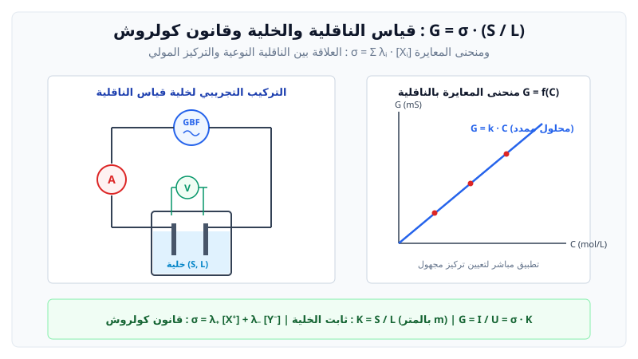

# قياس الناقلية وكمية المادة

> **المحاليل الشاردية:**  
> هي محاليل مائية تحتوي على شوارد موجبة وسالبة حرة الحركة وتسمح بمرور التيار الكهربائي.

---

## 1. الناقلية الكهربائية لمحلول شاردي ($G$)

$$G = \frac{1}{R} = \frac{I}{U}$$
حيث:
* $G$: الناقلية بوحدة السيمنس ($\text{S}$).
* $R$: مقاومة جزء المحلول المحصور بين الصفيحتين بالأوم ($\Omega$).
* $I$: شدة التيار الفعالة بالأمبير ($\text{A}$).
* $U$: التوتر الفعال بالفولت ($\text{V}$).

---

## 2. الناقلية النوعية لمحلول شاردي ($\sigma$) وقانون كولروش

تتعلق الناقلية بهندسة خلية القياس (مساحة الصفيحة $S$ والبعد بينهما $L$):
$$G = \sigma \cdot \frac{S}{L} = \sigma \cdot K$$
حيث $K = \dfrac{S}{L}$ هو **ثابت الخلية** بالمتر ($\text{m}$)، و $\sigma$ هي **الناقلية النوعية** بـ ($\text{S}\cdot\text{m}^{-1}$).

> **قانون كولروش (Loi de Kohlrausch):**  
> في المحاليل الممددة جداً، تساوي الناقلية النوعية مجموع جداءات التراكيز المولية الفعلية للشوارد في ناقلياتها النوعية المولية الشاردية:
> $$\sigma = \sum \lambda_i [X_i] = \lambda_1 [X_1] + \lambda_2 [X_2] + \dots$$

> [!CAUTION]
> في قانون كولروش، يجب التعبير عن التراكيز المولية بوحدة:
> $$[X_i] \text{ بـ } \mathbf{mol/m^3} \quad (1 \text{ mol/L} = 1000 \text{ mol/m}^3)$$

---

## 3. العوامل المؤثرة على الناقلية وتطبيقات المعايرة

> * **درجة الحرارة:** تزداد الناقلية بارتفاع درجة الحرارة لأن حركة الشوارد ولزوجة المحلول تتحسن.
> * **طبيعة الشوارد:** تختلف الناقلية النوعية المولية الشاردية $\lambda$ من شاردة لأخرى، وأكبرها في المحاليل المائية هما شاردة الهيدرونيوم $\text{H}_3\text{O}^+$ وشاردة الهيدروكسيد $\text{OH}^-$.
> * **التركيز المولي:** في التراكيز المنخفضة ($C \le 10^{-2} \text{ mol/L}$)، تتناسب الناقلية طرداً مع التركيز: $\sigma = k \cdot C$.

---

## 4. بنك التمارين التدريبية والنموذجية (مع الحلول المفصلة)

### 📌 التمرين الأول: حساب الناقلية وتعيين تركيز مجهول بقانون كولروش
نغمر خلية قياس الناقلية ثابِتها $K = 1.0 \times 10^{-2} \text{ m}$ في محلول مائي لكلور الكالسيوم $(\text{Ca}^{2+} + 2\text{Cl}^-)$ تركيزه المولي $C = 2.0 \times 10^{-3} \text{ mol/L}$ عند درجة حرارة $25^\circ\text{C}$.
يُعطى:
* $\lambda(\text{Ca}^{2+}) = 11.9 \times 10^{-3} \text{ S}\cdot\text{m}^2/\text{mol}$
* $\lambda(\text{Cl}^-) = 7.63 \times 10^{-3} \text{ S}\cdot\text{m}^2/\text{mol}$

1. اكتب معادلة انحلال كلور الكالسيوم الصلب $\text{CaCl}_2$ في الماء.
2. احسب التركيز الفعلي لكل من شاردتي الكالسيوم $[\text{Ca}^{2+}]$ والكلور $[\text{Cl}^-]$ في المحلول بوحدة $\text{mol/L}$ ثم بوحدة $\text{mol/m}^3$.
3. عبّر عن الناقلية النوعية $\sigma$ للمحلول بدلالة التراكيز الشاردية وناقلياتها المولية، ثم احسب قيمتها.
4. استنتج قيمة الناقلية $G$ المعقاسة بهذه الخلية بوحدة الميلي سيمنس ($\text{mS}$).
5. إذا كان التوتر الفعال المطبق بين صفيحتي الخلية هو $U = 1.2 \text{ V}$، فما هي شدة التيار الفعالة $I$ المارة في الدارة؟

---

### 💡 الحل المفصل للتمرين الأول:
1. **معادلة الانحلال في الماء:**
   $$\text{CaCl}_2(s) \xrightarrow{\text{H}_2\text{O}} \text{Ca}^{2+}(aq) + 2\text{Cl}^-(aq)$$

2. **التراكيز المولية الفعلية للشوارد:**
   * $[\text{Ca}^{2+}] = C = 2.0 \times 10^{-3} \text{ mol/L}$.
   * $[\text{Cl}^-] = 2C = 2 \times (2.0 \times 10^{-3}) = 4.0 \times 10^{-3} \text{ mol/L}$.
   * **التحويل إلى وحدة $\text{mol/m}^3$ (الضرب في $10^3$):**
     * $[\text{Ca}^{2+}] = 2.0 \times 10^{-3} \times 10^3 = 2.0 \text{ mol/m}^3$.
     * $[\text{Cl}^-] = 4.0 \times 10^{-3} \times 10^3 = 4.0 \text{ mol/m}^3$.

3. **حساب الناقلية النوعية $\sigma$ بقانون كولروش:**
   $$\sigma = \lambda(\text{Ca}^{2+}) [\text{Ca}^{2+}] + \lambda(\text{Cl}^-) [\text{Cl}^-]$$
   $$\sigma = (11.9 \times 10^{-3} \times 2.0) + (7.63 \times 10^{-3} \times 4.0)$$
   $$\sigma = (23.8 \times 10^{-3}) + (30.52 \times 10^{-3}) = 54.32 \times 10^{-3} \text{ S/m} = 5.432 \times 10^{-2} \text{ S/m}$$

4. **حساب الناقلية $G$:**
   $$G = \sigma \cdot K = (5.432 \times 10^{-2} \text{ S/m}) \times (1.0 \times 10^{-2} \text{ m}) = 5.432 \times 10^{-4} \text{ S} = 0.5432 \text{ mS}$$

5. **حساب شدة التيار الفعالة $I$:**
   $$G = \dfrac{I}{U} \implies I = G \cdot U = (5.432 \times 10^{-4} \text{ S}) \times 1.2 \text{ V} \approx 6.52 \times 10^{-4} \text{ A} = 0.652 \text{ mA}$$
