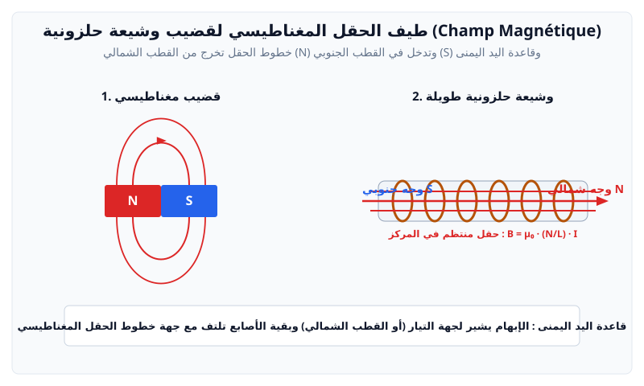

# الظواهر الكهرومغناطيسية

---

## 1. الحقل المغناطيسي المتولد عن تيار كهربائي

الحقل المغناطيسي كمية شعاعية $\vec{B}$ تقاس وحدته بـ **التسلا** ($T$):

* **بالقرب من سلك مستقيم طويل جداً يمر به تيار $I$ (على مسافة $d$ منه):**
  $$B = \frac{\mu_0 \cdot I}{2\pi d}$$
* **في مركز وشيعة مسطحة عدد لفاتها $N$ ونصف قطرها $R$:**
  $$B = \mu_0 \frac{N \cdot I}{2R}$$
* **في مركز وشيعة حلزونية طويلة (Solénoïde) طولها $L$ وعدد لفاتها $N$:**
  $$B = \mu_0 \frac{N}{L} I = \mu_0 \cdot n \cdot I$$
  حيث $n = \dfrac{N}{L}$ هو عدد اللفات في وحدة الأطوال، و $\mu_0 = 4\pi \times 10^{-7} \text{ T}\cdot\text{m/A}$.
* **تحديد اتجاه $\vec{B}$:** باستعمال **قاعدة اليد اليمنى** (الإبهام يشير إلى جهة التيار، والأصابع تلتف مشيرة لخطوط الحقل، أو العكس في الوشائع).

---

## 2. قوة لابلاس الكهرومغناطيسية (Force de Laplace)

يخضع جزء من ناقل مستقيم طوله $l$ يمر به تيار كهربائي $I$ ومغمور في حقل مغناطيسي منتظم $\vec{B}$ إلى قوة كهرومغناطيسية تدعى **قوة لابلاس**:
$$\vec{F} = I (\vec{l} \wedge \vec{B}) \quad \Longrightarrow \quad F = I \cdot l \cdot B \cdot \sin(\theta)$$
* $\theta$: الزاوية الهندسية بين شعاع التيار $\vec{I}$ وشعاع الحقل المغناطيسي $\vec{B}$.
* **تحديد جهة القوة $\vec{F}$:** بقاعدة أصابع اليد اليمنى الثلاثة (الإبهام: التيار $I$، السبابة: الحقل $\vec{B}$، الوسطى: القوة $\vec{F}$).

---

## 3. التدفق المغناطيسي (Flux magnétique $\Phi$)

يعبر التدفق المغناطيسي عبر سطح $S$ عن عدد خطوط الحقل المغناطيسي المخترقة لهذا السطح:
$$\Phi = \vec{B} \cdot \vec{S} = B \cdot S \cdot \cos(\theta)$$
حيث $\Phi$ يقاس بوحدة **الويبر** ($\text{Wb}$)، و $\theta$ هي الزاوية بين الناظم على السطح $\vec{n}$ وشعاع الحقل $\vec{B}$.

---

## 4. التحريض الكهرومغناطيسي والتحريض الذاتي (Auto-induction)

### أ. قانون فاراداي ولينز
> **قانون فاراداي ولينز:**  
> يتولد في دارة مغلقة تيار كهربائي متحرض وقوة محركة كهربائية متحرضة $e$ كلما حدث تغير في التدفق المغناطيسي $\Phi$ المخترق للدارة بالنسبة للزمن:
> $$e(t) = -\frac{d\Phi}{dt}$$
> وتعمل هذه القوة المتحرضة على توليد تيار متحرض ينتج عنه حقل مغناطيسي متحرض **يعاكس بآثاره السبب الذي أحدثه** (قانون لينز).

### ب. ظاهرة التحريض الذاتي (L'auto-induction)
عندما يمر تيار متغير $i(t)$ في وشيعة ذاتيتها $L$:
* **تدفق التحريض الذاتي الخاص:**
  $$\Phi = L \cdot i$$
* **ذاتية وشيعة حلزونية (Inductance $L$ بالهنري $\text{H}$):**
  $$L = \mu_0 \frac{N^2 \cdot S}{l} = \mu_0 \cdot n^2 \cdot S \cdot l$$
* **القوة المحركة الكهربائية للتحريض الذاتي:**
  $$e = -\frac{d\Phi}{dt} = -L \frac{di}{dt}$$
* **الطاقة الكهرومغناطيسية المخزنة في الوشيعة ($E_L$ بالجول $\text{J}$):**
  $$E_L = \frac{1}{2} L \cdot i^2$$

---

## 5. بنك التمارين والمسائل التدريبية (مع الحلول المفصلة)

### 📌 التمرين الأول: الحقل المغناطيسي لوشيعة حلزونية وتراكب الحقول
وشيعة حلزونية طولها $L = 50 \text{ cm} = 0.5 \text{ m}$، تحتوي على $N = 1000$ لفة، ونصف قطرها صغير مقارنة بطولها.
يمر بها تيار كهربائي مستمر شدته $I = 2 \text{ A}$.
تُعطى الثابتة المغناطيسية: $\mu_0 = 4\pi \times 10^{-7} \text{ T}\cdot\text{m/A}$.
تُعطى المركبة الأفقية للحقل المغناطيسي الأرضي: $B_H = 2.0 \times 10^{-5} \text{ T}$.

1. احسب شدة الحقل المغناطيسي $B_0$ المتولد داخل الوشيعة في مركزها.
2. نضع إبرة ممغنطة في مركز الوشيعة بحيث يكون محور الوشيعة متعامداً مع الزوال المغناطيسي الأرضي (اتجاه $B_H$):
   * احسب زاوية انحراف الإبرة الممغنطة $\alpha$ بالنسبة للزوال المغناطيسي الأرضي.
   * احسب شدة الحقل المغناطيسي الكلي $B_T$ في مركز الوشيعة.
3. قضيب ناقل طوله $l = 10 \text{ cm}$ موضوع أفقياً داخل حقل مغناطيسي منتظم عمودي عليه شدته $B = 0.5 \text{ T}$. يمر بالقضيب تيار $I = 3 \text{ A}$:
   * احسب شدة قوة لابلاس (قوة لورنتز الكهرومغناطيسية) المؤثرة على القضيب.

---

### 💡 الحل المفصل للتمرين الأول:
1. **حساب شدة الحقل المغناطيسي للوشيعة $B_0$:**
   $$B_0 = \mu_0 \cdot \dfrac{N}{L} \cdot I = (4\pi \times 10^{-7}) \times \left(\dfrac{1000}{0.5}\right) \times 2$$
   $$B_0 = 4\pi \times 10^{-7} \times 2000 \times 2 = 1.6\pi \times 10^{-3} \text{ T} \approx 5.03 \times 10^{-3} \text{ T}$$

2. **حساب زاوية انحراف الإبرة $\alpha$ والحقل الكلي $B_T$:**
   * الحقلان $\vec{B}_0$ و $\vec{B}_H$ متعامدان:
     $$\tan(\alpha) = \dfrac{B_0}{B_H} = \dfrac{5.03 \times 10^{-3}}{2.0 \times 10^{-5}} = 251.5$$
     $$\alpha = \arctan(251.5) \approx 89.77^\circ$$
     *(نلاحظ أن حقل الوشيعة أقوى بكثير جداً من الحقل المغناطيسي الأرضي، فتنحرف الإبرة لتأخذ تقريباً اتجاه محور الوشيعة).*
   * شدة الحقل الكلي:
     $$B_T = \sqrt{B_0^2 + B_H^2} \approx B_0 \approx 5.03 \times 10^{-3} \text{ T}$$

3. **حساب قوة لابلاس (Force de Laplace):**
   * قانون لابلاس: $F = I \cdot l \cdot B \cdot \sin(\theta)$
   * بما أن القضيب عمودي على خطوط الحقل المغناطيسي ($\theta = 90^\circ \implies \sin 90^\circ = 1$):
     $$F = 3 \text{ A} \times 0.1 \text{ m} \times 0.5 \text{ T} \times 1 = 0.15 \text{ N}$$
