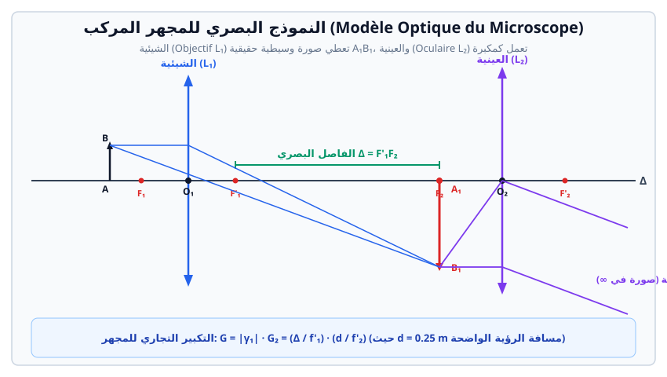

# الأجهزة البصرية: المكبرة، المجهر والمنظار الفلكي



> **الهدف من الأجهزة البصرية:**  
> تمكين العين البشرية من رؤية تفاصيل أجسام دقيقة جداً وقريبة (بالمكبرة والمجهر) أو أجسام بعيدة جداً وزوايا رؤيتها صغيرة (بالمنظار الفلكي والتلسكوب)، مع تحقيق راحة العين (رؤية بدون إجهاد).

---

## 1. المكبرة (La Loupe)

المكبرة هي عدسة مقربة بسيطة بعدها المحرقي $f'$ صغير (عادة بين $2 \text{ cm}$ و $5 \text{ cm}$).

### أ. مبدأ العمل والرؤية دون إجهاد
* يُوضع الجسم $AB$ بين المركز البصري $O$ والمحرق الجسمي $F$ ($0 < OA \leq f'$).
* تعطي المكبرة صورة $A'B'$ افتراضية، معتدلة ومكبرة.
* **الرؤية دون إجهاد (Vision à l'infini):** عند وضع الجسم تماماً في المحرق الجسمي ($A \equiv F$)، تخرج الأشعة من العدسة متوازية، فتتشكل الصورة في اللانهاية وتراها العين السليمة في حالة استرخاء تام دون تطابق عضلات العين.

### ب. القطر الظاهري والتكبير
* **القطر الظاهري للجسم بالعين المجردة ($\theta$):**  
  تُقاس أصغر مسافة للرؤية الواضحة بالعين المجردة بدون إجهاد وتُسمى المدى الأدنى للرؤية الواضحة (Punctum Proximum) وقيمته الاصطلاحية $d_m = 25 \text{ cm} = 0.25 \text{ m}$:
  $$\tan \theta \approx \theta = \frac{AB}{d_m}$$
* **القطر الظاهري للصورة عبر المكبرة ($\theta'$):**
  $$\tan \theta' \approx \theta' = \frac{AB}{f'}$$
* **التكبير التجاري للمكبرة ($G_c$):**
  $$G_c = \frac{\theta'}{\theta} = \frac{d_m}{f'} = \frac{0.25}{f'(\text{m})}$$

---

## 2. المجهر الضوئي المركب (Le Microscope optique)

يتكون المجهر من جملة بصرية تضم عدستين مقربتين تشتركان في نفس المحور البصري:

```
الجسم AB  ---> [ العدسة الشيئية L₁ ] ---> الصورة الوسيطية A₁B₁ ---> [ العدسة العينية L₂ ] ---> الصورة النهائية A'B' في ∞
```

### أ. مركبات المجهر
1. **الشيئية (L'objectif - $L_1$):**
   * عدسة مقربة موجهة نحو الجسم المراد فحصه، بعدها المحرقي $f'_1$ صغير جداً (بضعة مليمترات).
   * يُوضع الجسم $AB$ أمام محرقها الجسمي بقليل ($OA > f'_1$).
   * تعطي صورة وسيطية $A_1 B_1$ حقيقية، مقلوبة ومكبرة جداً.
2. **العينية (L'oculaire - $L_2$):**
   * عدسة مقربة موجهة نحو عين الراصد، بعدها المحرقي $f'_2$ أكبر من $f'_1$ (بضعة سنتيمترات).
   * تلعب دور المكبرة لفحص الصورة الوسيطية $A_1 B_1$.

### ب. الفاصل البصري للمجهر ($\Delta$)
هو المسافة الثابتة هندسياً في هيكل المجهر بين المحرق الصوري للشيئية والمحرق الجسمي للعينية:
$$\Delta = F'_1 F_2 = O_1 O_2 - (f'_1 + f'_2)$$
في معظم المجاهر المعيارية تكون $\Delta$ محصورة بين $16 \text{ cm}$ و $20 \text{ cm}$.

### جـ. ضبط المجهر للرؤية دون إجهاد (ضبط لا محرقي للصورة النهائية)
* تُضبط وضعية العينية بحيث تنطبق الصورة الوسيطية $A_1 B_1$ تماماً على المحرق الجسمي للعينية ($A_1 \equiv F_2$).
* تتشكل الصورة النهائية الافتراضية $A'B'$ في اللانهاية، فترصدها العين مسترخية تماماً.

### د. تكبير المجهر
* **التكبير الخطي للشيئية ($\gamma_1$):**
  $$\gamma_1 = -\frac{\overline{A_1 B_1}}{\overline{AB}} = -\frac{\Delta}{f'_1}$$
  حيث تدل الإشارة السالبة على أن الصورة مقلوبة.
* **التكبير التجاري للعينية ($G_2$):**
  $$G_2 = \frac{d_m}{f'_2} = \frac{0.25}{f'_2}$$
* **التكبير التجاري الكلي للمجهر ($G$):**
  $$G = |\gamma_1| \times G_2 = \frac{\Delta}{f'_1} \times \frac{d_m}{f'_2} = \frac{\Delta \cdot d_m}{f'_1 \cdot f'_2}$$
  *(مع الانتباه لتجانس الوحدات، وجميعها بالمتر $\text{m}$).*

---

## 3. المنظار الفلكي (La Lunette astronomique)

يُستعمل لرصد الأجرام السماوية والأجسام البعيدة جداً (الموجودة في اللانهاية).

### أ. التركيب والضبط اللامحرقي (Système afocal)
* يتكون من شيئية $L_1$ بعدها المحرقي كبير $f'_1$ وعينية $L_2$ بعدها المحرقي صغير $f'_2$.
* يكون الجهاز في وضع ضبط لا محرقي عندما ينطبق المحرق الصوري للشيئية على المحرق الجسمي للعينية:
  $$F'_1 \equiv F_2$$
* المسافة بين مركزي العدستين تساوي مجموع البعدين المحرقيين:
  $$O_1 O_2 = f'_1 + f'_2$$

### ب. التكبير الزاوي للمنظار الفلكي ($G$)
$$G = \frac{\theta'}{\theta} = \frac{f'_1}{f'_2}$$
* $\theta$: زاوية النظر للجرم البعيد بالعين المجردة.
* $\theta'$: زاوية النظر للصورة عبر العينية.

---

## 4. تمارين نموذجية محلولة بالتفصيل

### تمرين 1: حساب خصائص مجهر ضوئي
مجهر ضوئي يتألف من:
* شيئية $L_1$ قوتها $C_1 = 200 \ \delta$ (ديوبتري).
* عينية $L_2$ قوتها $C_2 = 50 \ \delta$.
* المسافة بين المركزين البصريين للعدستين هي $O_1 O_2 = 22.5 \text{ cm}$.
* المدى الأدنى للرؤية الواضحة $d_m = 25 \text{ cm}$.

1. احسب البعد المحرقي $f'_1$ و $f'_2$ لكل من الشيئية والعينية بالمتر وبالسنتيمتر.  
2. احسب الفاصل البصري $\Delta$ للمجهر.  
3. تم ضبط المجهر بحيث يرى راصد سليم العين صورة نهائية في اللانهاية دون إجهاد:
   - أين تتشكل الصورة الوسيطية $A_1 B_1$؟
   - احسب التكبير الخطي للشيئية $|\gamma_1|$.
   - احسب التكبير التجاري للعينية $G_2$.
   - استنتج التكبير التجاري الإجمالي $G$ للمجهر.
4. إذا كان طول العينة المفحوصة $AB = 0.05 \text{ mm}$، احسب طول الصورة الوسيطية $A_1 B_1$ والزاوية $\theta'$ التي تُرى بها الصورة من خلال العينية.

#### الحل المفصل:
1. **حساب الأبعاد المحرقية:**
   $$f'_1 = \frac{1}{C_1} = \frac{1}{200} = 0.005 \text{ m} = 0.5 \text{ cm} = 5 \text{ mm}$$
   $$f'_2 = \frac{1}{C_2} = \frac{1}{50} = 0.02 \text{ m} = 2 \text{ cm} = 20 \text{ mm}$$

2. **حساب الفاصل البصري $\Delta$:**
   $$\Delta = O_1 O_2 - (f'_1 + f'_2) = 22.5 - (0.5 + 2) = 20 \text{ cm} = 0.2 \text{ m}$$

3. **حساب التكبيرات:**
   - تتشكل الصورة الوسيطية $A_1 B_1$ في المحرق الجسمي للعينية $F_2$ ($A_1 \equiv F_2$).
   - التكبير الخطي للشيئية:
     $$|\gamma_1| = \frac{\Delta}{f'_1} = \frac{20 \text{ cm}}{0.5 \text{ cm}} = 40$$
   - التكبير التجاري للعينية:
     $$G_2 = \frac{d_m}{f'_2} = \frac{25 \text{ cm}}{2 \text{ cm}} = 12.5$$
   - التكبير التجاري الإجمالي للمجهر:
     $$G = |\gamma_1| \times G_2 = 40 \times 12.5 = 500$$

4. **طول الصورة الوسيطية وزاوية الرؤية:**
   $$A_1 B_1 = |\gamma_1| \times AB = 40 \times 0.05 \text{ mm} = 2.0 \text{ mm} = 2 \times 10^{-3} \text{ m}$$
   $$\theta' = \frac{A_1 B_1}{f'_2} = \frac{2 \times 10^{-3} \text{ m}}{0.02 \text{ m}} = 0.1 \text{ rad}$$

---

### تمرين 2: المنظار الفلكي
منظار فلكي مخصص لرصد القمر، شيئيته بعدها المحرقي $f'_1 = 120 \text{ cm}$ وعينيته بعدها المحرقي $f'_2 = 4 \text{ cm}$.  
1. في حالة الضبط اللامحرقي، احسب المسافة $O_1 O_2$ الفاصلة بين العدستين.  
2. احسب التكبير الزاوي $G$ لهذا المنظار.  
3. نعتبر القطر الظاهري للقمر بالعين المجردة هو $\theta = 0.009 \text{ rad}$ (حوالي نصف درجة):
   - احسب القطر الظاهري $\theta'$ للقمر عند رصده عبر هذا المنظار.
   - احسب قطر الصورة الحقيقية للقمر المتشكلة في المحرق الصوري للشيئية.

#### الحل المفصل:
1. **المسافة بين العدستين في الضبط اللامحرقي:**
   $$O_1 O_2 = f'_1 + f'_2 = 120 + 4 = 124 \text{ cm} = 1.24 \text{ m}$$

2. **التكبير الزاوي:**
   $$G = \frac{f'_1}{f'_2} = \frac{120}{4} = 30$$

3. **حساب القطر الظاهري وأبعاد الصورة:**
   $$\theta' = G \times \theta = 30 \times 0.009 = 0.27 \text{ rad} \approx 15.5^\circ$$
   * قطر صورة القمر في محرق الشيئية $A_1 B_1$:
     $$A_1 B_1 = f'_1 \times \theta = 1.20 \text{ m} \times 0.009 \text{ rad} = 0.0108 \text{ m} = 10.8 \text{ mm}$$
